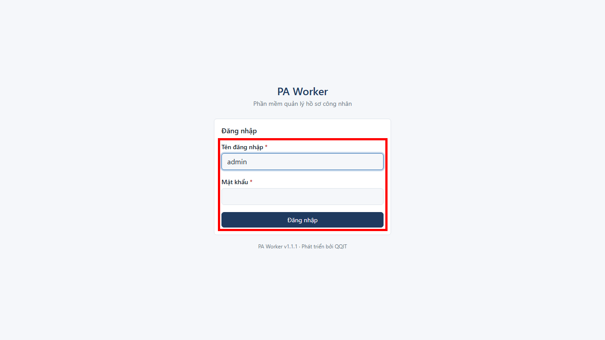
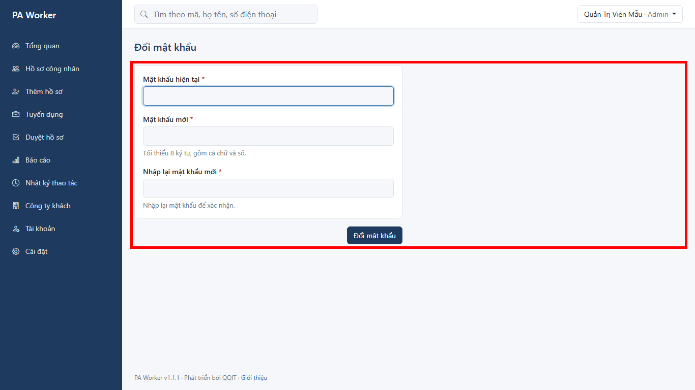
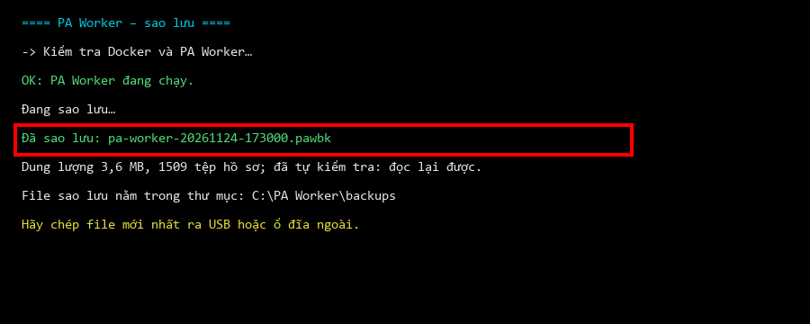

# Hướng dẫn cài đặt PA Worker (Windows)

Phiên bản 1.1.0 · Dành cho người cài đặt và quản trị hệ thống, không cần biết lập trình.

PA Worker chạy trên **một máy tính Windows** trong công ty (gọi là **máy chủ**). Các máy khác trong cùng mạng nội bộ chỉ cần trình duyệt Chrome hoặc Edge để dùng. Phần mềm chạy bên trong **Docker Desktop**, nên bạn không phải cài Python, cơ sở dữ liệu hay phần mềm nhận diện chữ.

> Chỉ hỗ trợ Windows 10/11. Bản cho macOS chưa có trong bàn giao này.

Những chỗ ghi **[ẢNH CẦN CHỤP]** là bước trên máy Windows sạch mà đơn vị phát triển chưa chụp được. Người cài đặt chụp màn hình thật rồi chèn vào.

## Mục lục

1. [Chuẩn bị](#1-chuẩn-bị)
2. [Bật ảo hóa và cài Docker Desktop](#2-bật-ảo-hóa-và-cài-docker-desktop)
3. [Chép thư mục PA Worker](#3-chép-thư-mục-pa-worker)
4. [Chạy lần đầu](#4-chạy-lần-đầu)
5. [Cất khóa mã hóa (bắt buộc)](#5-cất-khóa-mã-hóa-bắt-buộc)
6. [Cho máy khác trong mạng truy cập](#6-cho-máy-khác-trong-mạng-truy-cập)
7. [Đăng nhập lần đầu](#7-đăng-nhập-lần-đầu)
8. [Dùng hằng ngày](#8-dùng-hằng-ngày)
9. [Sao lưu](#9-sao-lưu)
10. [Phục hồi](#10-phục-hồi)
11. [Cập nhật phiên bản mới](#11-cập-nhật-phiên-bản-mới)
12. [HTTPS](#12-https)
13. [Bảng tóm tắt các tệp bấm chạy](#13-bảng-tóm-tắt-các-tệp-bấm-chạy)

Gặp lỗi ở bất kỳ bước nào: xem [Xử lý sự cố](xu-ly-su-co.md).

## 1. Chuẩn bị

| Hạng mục | Yêu cầu |
| --- | --- |
| Hệ điều hành | Windows 10 (bản 22H2) hoặc Windows 11, 64-bit |
| Bộ nhớ (RAM) | Tối thiểu 8 GB, nên có 16 GB |
| Ổ đĩa | Còn trống tối thiểu 20 GB; dữ liệu và bản sao lưu tăng theo số hồ sơ, tài liệu |
| Internet | Cần khi cài lần đầu và khi cập nhật (tải Docker Desktop và các thành phần, khoảng 2–3 GB). Khi đã cài xong, phần mềm chạy **không cần Internet** |
| Quyền | Tài khoản Windows có quyền Administrator (để cài Docker Desktop và mở tường lửa) |
| Thời gian | Khoảng 30 phút nếu mạng ổn định (lần đầu dựng hệ thống mất 10–20 phút) |
| Khác | Một USB riêng để cất khóa mã hóa và bản sao lưu |

Máy chủ nên **cắm điện, nối mạng dây, đặt địa chỉ IP cố định** (nhờ người quản lý mạng đặt trên router), và không để chế độ ngủ trong giờ làm việc.

## 2. Bật ảo hóa và cài Docker Desktop

### 2.1 Kiểm tra ảo hóa

1. Nhấn `Ctrl + Shift + Esc` để mở **Task Manager**.
2. Chọn tab **Performance** (Hiệu suất) → **CPU**.
3. Xem dòng **Virtualization** (Ảo hóa): phải là **Enabled** (Đã bật).

[ẢNH CẦN CHỤP: Task Manager, tab Performance, CPU, dòng Virtualization: Enabled]

Nếu là **Disabled**: khởi động lại máy, vào BIOS/UEFI (thường bấm `F2`, `F10`, `Del` hoặc `Esc` ngay khi máy vừa bật, tùy hãng), tìm mục **Intel Virtualization Technology (VT-x)** hoặc **SVM Mode (AMD)**, chọn **Enabled**, lưu (`F10`) và khởi động lại. Không chắc thì nhờ bộ phận IT hoặc xem hướng dẫn của hãng máy.

### 2.2 Cài WSL 2

1. Nhấp chuột phải nút Start → **Terminal (Admin)** hoặc **Windows PowerShell (Admin)** → chọn **Yes**.
2. Gõ lệnh sau rồi nhấn Enter:
   ```
   wsl --install --no-distribution
   ```
3. Chờ chạy xong rồi **khởi động lại máy**.

[ẢNH CẦN CHỤP: cửa sổ PowerShell (Admin) sau khi chạy wsl --install]

Nếu báo WSL đã có sẵn thì chạy thêm `wsl --update`.

### 2.3 Cài Docker Desktop

1. Tải **Docker Desktop for Windows** tại https://www.docker.com/products/docker-desktop/ (nút *Download for Windows – AMD64*).
2. Chạy tệp vừa tải. Ở màn hình cấu hình, **giữ dấu tích "Use WSL 2 instead of Hyper-V"** → **OK**.
3. Cài xong bấm **Close and restart** (máy khởi động lại).
4. Mở **Docker Desktop** từ menu Start. Lần đầu: chấp nhận điều khoản (**Accept**); màn hình đăng nhập Docker có thể bỏ qua (**Skip** / *Continue without signing in*).
5. Chờ góc dưới bên trái hiện **Engine running** (màu xanh).
6. Vào **Settings** (biểu tượng bánh răng) → **General** → tích **Start Docker Desktop when you sign in to your computer** → **Apply**. Nhờ vậy mỗi lần bật máy, Docker và PA Worker tự chạy.

[ẢNH CẦN CHỤP: màn hình cấu hình khi cài, có dấu tích Use WSL 2]
[ẢNH CẦN CHỤP: Docker Desktop báo Engine running]
[ẢNH CẦN CHỤP: Settings > General, tích Start Docker Desktop when you sign in]

## 3. Chép thư mục PA Worker

1. Giải nén tệp `pa-worker-v1.1.0.zip` vào một thư mục cố định trên máy chủ, ví dụ `C:\PA Worker`.
2. **Không** đặt trong thư mục đồng bộ OneDrive/Google Drive, cũng không đặt trên USB hay ổ mạng.
3. Mở thư mục, bạn sẽ thấy các tệp `PA Worker.bat`, `Sao luu.bat`, `Phuc hoi.bat`, `Cap nhat.bat`, `Kiem tra.bat` và các thư mục `apps`, `docs`, `scripts`…

Nếu Windows hỏi "Windows protected your PC" khi chạy tệp `.bat`: bấm **More info** → **Run anyway**.

## 4. Chạy lần đầu

1. Bấm đúp **`PA Worker.bat`**. Một cửa sổ chữ đen mở ra; **không đóng cửa sổ này** cho tới khi nó báo xong.
2. Nếu Docker Desktop chưa chạy, tệp sẽ tự mở và chờ tối đa 5 phút.
3. Cửa sổ hỏi loại bản cài:
   - **1. Bản Thật**: dùng cho dữ liệu công nhân thật của doanh nghiệp. Hệ thống trống, chỉ có một tài khoản Admin.
   - **2. Bản Demo**: có sẵn 4 tài khoản mẫu (`admin`, `quanly`, `hr`, `viewer`) và khoảng 500 hồ sơ **giả lập**, để tập dùng và trình diễn.

   Gõ `1` hoặc `2` rồi nhấn Enter. **Không dùng bản Demo cho dữ liệu thật**; muốn chuyển sang dùng thật thì cài một bản Thật ở thư mục khác.
4. Tệp tạo tệp cấu hình `.env` chứa các khóa bảo mật, rồi nhắc cất khóa: làm ngay [bước 5](#5-cất-khóa-mã-hóa-bắt-buộc) rồi nhấn Enter.
5. Cửa sổ hỏi cho phép máy khác trong mạng truy cập: gõ `C` nếu nhân viên dùng PA Worker từ máy khác (xem [bước 6](#6-cho-máy-khác-trong-mạng-truy-cập)).
6. Tệp dựng và chạy hệ thống. **Lần đầu mất 10–20 phút** (tải và dựng các thành phần); các lần sau chỉ vài chục giây.
7. Khi hệ thống sẵn sàng:
   - **Bản Thật:** tệp hỏi tên đăng nhập cho Admin (Enter để dùng `admin`) rồi in **mật khẩu tạm**.
   - **Bản Demo:** tệp nạp dữ liệu giả lập (1–2 phút) rồi in **mật khẩu tạm của 4 tài khoản mẫu**.

   **Ghi lại mật khẩu tạm ngay**: mật khẩu chỉ hiện một lần trên cửa sổ này, không lưu ở đâu khác.
8. Trình duyệt tự mở trang đăng nhập `http://localhost:8000/dang-nhap/`.

Cửa sổ báo xong có dạng (bản Thật):

```
==== Tạo tài khoản Admin đầu tiên ====
Đã tạo tài khoản Admin: admin
Mật khẩu tạm (chỉ hiện một lần): ************
Ghi lại mật khẩu tạm ở trên; khi đăng nhập lần đầu hệ thống yêu cầu đổi mật khẩu.
==== PA Worker đã chạy ====
Trên máy này:            http://localhost:8000
Từ máy khác trong mạng:  http://192.168.1.20:8000
```

[ẢNH CẦN CHỤP: cửa sổ PA Worker.bat sau khi cài xong (che mật khẩu tạm trước khi chụp)]

## 5. Cất khóa mã hóa (bắt buộc)

Tệp **`.env`** trong thư mục PA Worker chứa các khóa bảo mật, trong đó có hai **khóa mã hóa** `FIELD_ENCRYPTION_KEY` và `HASH_KEY`:

- Số CCCD, số CMND cũ, địa chỉ thường trú, lương và giá trị chi tiết trong nhật ký được mã hóa bằng khóa này.
- **Mọi file sao lưu cũng được mã hóa bằng khóa này**, và khóa **không** nằm trong file sao lưu.
- **Mất khóa thì không ai đọc lại được dữ liệu đã mã hóa và không phục hồi được bất kỳ bản sao lưu nào.** Không có cách lấy lại khóa.

Việc phải làm ngay sau khi cài:

1. Chép tệp `.env` vào **một USB riêng**, dán nhãn "PA Worker – khóa", cất trong tủ có khóa. Nên làm hai bản, để ở hai nơi khác nhau.
2. Hoặc mở `.env` bằng Notepad, in ra giấy, cho vào phong bì niêm phong, ký tên ngoài phong bì, cất trong két.
3. **Không** gửi tệp `.env` qua email, Zalo, tin nhắn; không chụp ảnh lưu trên điện thoại; không để chung USB với file sao lưu.
4. Không sửa, không xóa tệp `.env`. Phần mềm không cho đổi khóa sau khi cài.

Nếu tệp `.env` trên máy chủ bị mất hoặc sai khóa, PA Worker **từ chối khởi động** và báo lỗi bằng tiếng Việt. Khi đó chép lại tệp `.env` từ USB (xem [Xử lý sự cố](xu-ly-su-co.md#mất-hoặc-sai-khóa-mã-hóa)).

## 6. Cho máy khác trong mạng truy cập

Máy khác truy cập bằng địa chỉ `http://<IP máy chủ>:8000`, ví dụ `http://192.168.1.20:8000`. Cần hai việc:

**a. Thêm IP máy chủ vào danh sách được phép** (`ALLOWED_HOSTS`):
- `PA Worker.bat` tự tìm IP và hỏi; gõ `C` là xong.
- Xem IP bằng tay: mở PowerShell, gõ `ipconfig`, đọc dòng **IPv4 Address** của card mạng đang dùng (Ethernet hoặc Wi-Fi).
- Thiếu bước này thì máy khác thấy trang **"Yêu cầu không hợp lệ"** nhắc tới ALLOWED_HOSTS.
- **Khi IP máy chủ thay đổi**, chạy lại `PA Worker.bat` và gõ `C` để thêm IP mới. Nên nhờ quản lý mạng đặt IP cố định để khỏi phải làm lại.

**b. Mở cổng 8000 trên tường lửa Windows:**
1. Mở thư mục `scripts\windows`, nhấp chuột phải tệp **`mo-cong-8000.ps1`** → **Run with PowerShell** → **Yes**.
2. Kiểm tra mạng của máy chủ đang là **Private**: Settings → Network & internet → Ethernet (hoặc Wi-Fi) → **Network profile type: Private network**.

Hoặc chạy lệnh trong PowerShell (Admin):

```
New-NetFirewallRule -DisplayName "PA Worker (cong 8000)" -Direction Inbound -Protocol TCP -LocalPort 8000 -Profile Private -Action Allow
```

[ẢNH CẦN CHỤP: Settings > Network & internet > Network profile type: Private]

Thử từ máy khác: mở Chrome/Edge, gõ `http://<IP máy chủ>:8000`. Thấy trang đăng nhập là được.

## 7. Đăng nhập lần đầu

1. Mở `http://localhost:8000` (trên máy chủ) hoặc `http://<IP máy chủ>:8000` (máy khác).
2. Nhập tên đăng nhập và **mật khẩu tạm** đã ghi ở bước 4.
3. Hệ thống chuyển ngay tới trang **Đổi mật khẩu**: nhập mật khẩu tạm, rồi mật khẩu mới hai lần. Mật khẩu mới tối thiểu 8 ký tự, có cả chữ và số.
4. Admin vào **Tài khoản** để tạo tài khoản cho Quản lý nhân sự, Nhân viên HR, Viewer (xem [Hướng dẫn sử dụng](huong-dan-su-dung.md#admin)).





Đăng nhập sai 5 lần liên tiếp thì tài khoản bị khóa tạm 15 phút. Không thao tác 30 phút thì tự đăng xuất.

## 8. Dùng hằng ngày

- Bật máy chủ, đăng nhập Windows: Docker Desktop tự chạy (nếu đã tích ở bước 2.3), PA Worker tự chạy theo. Khoảng 1–2 phút sau là dùng được.
- Hoặc bấm đúp `PA Worker.bat` bất cứ lúc nào: tệp kiểm tra, khởi động nếu cần và mở trình duyệt (an toàn khi chạy nhiều lần, không làm mất dữ liệu).
- Kiểm tra nhanh tình trạng hệ thống: bấm đúp **`Kiem tra.bat`** (khóa, dung lượng đĩa, bản sao lưu mới nhất).
- Không tắt máy chủ trong giờ làm việc. Tắt máy bình thường bằng Start → Shut down; không rút điện.

## 9. Sao lưu

### 9.1 Sao lưu tự động

PA Worker **tự sao lưu mỗi ngày một lần**, khi máy chủ đang bật: nếu trong 24 giờ qua chưa có bản sao lưu nào, hệ thống tạo một bản. Hệ thống giữ **14 bản mới nhất** trong thư mục **`backups`** (cạnh tệp `PA Worker.bat`); bản cũ hơn tự xóa.

- Tên file có ngày giờ: `pa-worker-20261124-173000.pawbk` (năm, tháng, ngày, giờ, phút, giây).
- Mỗi file chứa toàn bộ cơ sở dữ liệu và mọi tệp tài liệu, ảnh của hồ sơ, **đã được mã hóa**. File không chứa khóa.
- Sau khi tạo, hệ thống tự đọc lại toàn bộ file để chắc chắn phục hồi được.
- Ổ đĩa không đủ chỗ thì hệ thống không sao lưu và ghi cảnh báo (xem bằng `Kiem tra.bat`).

### 9.2 Sao lưu ngay

Bấm đúp **`Sao luu.bat`**: hệ thống tạo ngay một bản sao lưu, báo dung lượng và nhắc cất khóa. Nên chạy trước khi làm việc lớn (nhập Excel hàng loạt, cập nhật phiên bản).



```
Đang sao lưu…
Đã sao lưu: pa-worker-20261124-013919.pawbk
Dung lượng 3,6 MB, 1509 tệp hồ sơ; đã tự kiểm tra: đọc lại được, khớp nội dung.
```

### 9.3 Chép bản sao lưu ra ngoài máy chủ (bắt buộc)

Bản sao lưu chỉ nằm trên máy chủ thì không cứu được khi máy hỏng ổ, mất trộm hay cháy. **Ít nhất mỗi tuần một lần**, chép file mới nhất trong thư mục `backups` sang **ổ đĩa ngoài hoặc USB khác với USB cất khóa**.

Tự động chép mỗi ngày bằng Task Scheduler của Windows:

1. Cắm ổ đĩa ngoài, tạo thư mục, ví dụ `E:\PA Worker sao luu`.
2. Mở PowerShell trong thư mục PA Worker (Shift + chuột phải vào khoảng trống → *Open PowerShell window here*), chạy:
   ```
   powershell -ExecutionPolicy Bypass -File scripts\windows\dang-ky-chep-sao-luu.ps1 -Dest "E:\PA Worker sao luu"
   ```
3. Từ đó, mỗi ngày lúc 17:30 (và khi đăng nhập Windows nếu lỡ giờ), các file sao lưu mới được chép sang thư mục đích. Nhật ký chép ở `backups\chep-sao-luu.log`. Ổ ngoài không cắm thì lần đó bỏ qua.
4. Gỡ tác vụ: chạy lệnh trên kèm `-Remove`.

File sao lưu đã mã hóa, nhưng vẫn nên cất ổ ngoài ở nơi an toàn và **không để chung với USB khóa**. Ổ ngoài có BitLocker To Go thì tốt hơn.

## 10. Phục hồi

**Phục hồi thay toàn bộ dữ liệu đang có** bằng dữ liệu trong file sao lưu. Dữ liệu đang có được tự sao lưu trước (file `pa-worker-truoc-phuc-hoi-….pawbk`) để có thể quay lại.

### 10.1 Trên máy đang dùng

1. Bấm đúp **`Phuc hoi.bat`**.
2. Cửa sổ liệt kê các file sao lưu (mới nhất ở trên). Gõ số thứ tự file cần phục hồi.
3. Gõ đúng **`PHUC HOI`** (chữ in hoa) để xác nhận.
4. Tệp dừng hệ thống, kiểm tra file, phục hồi, đối chiếu số dòng và tệp, rồi khởi động lại. Thường mất dưới 1 phút với 500 hồ sơ.
5. Đăng nhập và kiểm tra dữ liệu.

File hỏng, bị sửa, hoặc khóa trong `.env` không khớp với file sao lưu thì phục hồi **bị từ chối** và dữ liệu đang có giữ nguyên.

### 10.2 Trên máy mới (máy chủ cũ hỏng)

1. Cài Docker Desktop trên máy mới ([bước 2](#2-bật-ảo-hóa-và-cài-docker-desktop)).
2. Giải nén **đúng phiên bản** PA Worker đang dùng (hoặc mới hơn) vào thư mục, ví dụ `C:\PA Worker`.
3. Chép tệp **`.env` từ USB cất khóa** vào thư mục đó.
4. Tạo thư mục `backups` trong thư mục đó, chép file sao lưu (`.pawbk`) từ ổ ngoài vào.
5. Bấm đúp **`Phuc hoi.bat`** (không cần chạy `PA Worker.bat` trước) → chọn file → gõ `PHUC HOI`. Lần đầu mất 10–20 phút để dựng hệ thống.
6. Chạy `PA Worker.bat` để mở trình duyệt; làm lại [bước 6](#6-cho-máy-khác-trong-mạng-truy-cập) nếu IP máy mới khác máy cũ.

Đăng nhập bằng tài khoản và mật khẩu như trên máy cũ.

## 11. Cập nhật phiên bản mới

Đơn vị phát triển gửi tệp `pa-worker-v<phiên bản>.zip`. Cập nhật không làm mất dữ liệu:

1. Chạy `Sao luu.bat` và chép file sao lưu ra ổ ngoài (phòng trường hợp xấu).
2. Giải nén tệp zip mới ra một thư mục tạm, rồi **chép đè tất cả** vào thư mục PA Worker đang dùng (chọn *Replace the files in the destination*). **Giữ nguyên** tệp `.env` và thư mục `backups` (bản zip không có hai thứ này nên không bị đè).
3. Bấm đúp **`Cap nhat.bat`**. Tệp làm lần lượt:
   1. sao lưu bằng phiên bản đang chạy;
   2. dựng phiên bản mới (cần Internet, vài phút);
   3. khởi động, tự cập nhật cơ sở dữ liệu;
   4. kiểm tra hệ thống, in phiên bản.
4. Đăng nhập, xem phiên bản ở chân trang (ví dụ "PA Worker v1.1.0") hoặc trang **Giới thiệu**.

Nếu phiên bản mới lỗi: chép lại các tệp của phiên bản cũ vào thư mục, chạy `Cap nhat.bat`, rồi `Phuc hoi.bat` với bản sao lưu vừa tạo ở bước 3.1.

Tên thư mục có thể đổi: hệ thống luôn dùng đúng dữ liệu cũ vì tên dự án Docker cố định là `pa_worker`. **Không** cài hai bản PA Worker trên cùng một máy.

## 12. HTTPS

Bản bàn giao chạy **HTTP trong mạng nội bộ** (địa chỉ bắt đầu bằng `http://`). Dữ liệu đi trong mạng LAN của công ty, không ra Internet.

Theo yêu cầu (mục VIII), khi triển khai thật nên dùng **HTTPS**. Việc này cần thêm một máy chủ trung gian (Caddy hoặc Nginx) và chứng chỉ, do người có chuyên môn IT làm. Khi đã có, đặt `HTTPS=1` trong `.env` rồi chạy lại `PA Worker.bat`: phần mềm bật cookie bảo mật và HSTS. Không bật `HTTPS=1` khi chưa có HTTPS, vì sẽ không đăng nhập được.

Không đưa PA Worker ra Internet (không mở cổng trên router).

## 13. Bảng tóm tắt các tệp bấm chạy

| Tệp | Dùng khi | Ghi chú |
| --- | --- | --- |
| `PA Worker.bat` | Cài lần đầu; mở phần mềm hằng ngày; thêm IP máy chủ | Chạy nhiều lần không sao |
| `Sao luu.bat` | Cần sao lưu ngay | Ngoài ra hệ thống tự sao lưu mỗi ngày |
| `Phuc hoi.bat` | Phục hồi dữ liệu từ file sao lưu | Thay toàn bộ dữ liệu; tự sao lưu dữ liệu cũ trước |
| `Cap nhat.bat` | Sau khi chép đè phiên bản mới | Tự sao lưu trước khi cập nhật |
| `Kiem tra.bat` | Kiểm tra tình trạng, khi có sự cố | Báo khóa, đĩa, bản sao lưu mới nhất |
| `scripts\windows\mo-cong-8000.ps1` | Một lần, để máy khác truy cập | Cần quyền Administrator |
| `scripts\windows\dang-ky-chep-sao-luu.ps1` | Một lần, tự chép sao lưu ra ổ ngoài | Task Scheduler |

Các lệnh nâng cao (cho người hỗ trợ kỹ thuật), chạy trong PowerShell tại thư mục PA Worker:

```
docker compose ps                                        # tình trạng các thành phần
docker compose logs --tail 50 web                        # nhật ký hệ thống gần nhất
docker compose exec web python manage.py system_check    # như Kiem tra.bat
docker compose exec web python manage.py backup          # như Sao luu.bat
docker compose exec web python manage.py reset_admin_password   # quên mật khẩu Admin
```
