# Hướng dẫn sử dụng PA Worker

Phiên bản 1.1.0 · Dành cho người dùng hằng ngày: Admin, Quản lý nhân sự, Nhân viên HR, Viewer.

Mở trình duyệt Chrome hoặc Edge, vào địa chỉ do Admin cung cấp (ví dụ `http://192.168.1.20:8000`). Ảnh minh họa chụp trên bản Demo; mọi tên người và số CCCD trong ảnh là **giả lập**.

## Mục lục

- [Dùng chung cho mọi vai trò](#dùng-chung-cho-mọi-vai-trò)
- [Nhân viên HR](#nhân-viên-hr)
- [Quản lý nhân sự](#quản-lý-nhân-sự)
- [Admin](#admin)
- [Viewer](#viewer)
- [Bảng quyền tóm tắt](#bảng-quyền-tóm-tắt)

## Dùng chung cho mọi vai trò

### Đăng nhập, đổi mật khẩu, đăng xuất

- Đăng nhập bằng tên đăng nhập và mật khẩu Admin cấp. Lần đầu hệ thống bắt đổi mật khẩu: tối thiểu 8 ký tự, có chữ và số.
- Đổi mật khẩu về sau: bấm tên của bạn ở góc phải trên → **Đổi mật khẩu**.
- Đăng xuất: bấm tên của bạn → **Đăng xuất**. Không thao tác 30 phút thì tự đăng xuất.
- Nhập sai mật khẩu 5 lần liên tiếp: tài khoản bị khóa tạm 15 phút. Cần gấp thì nhờ Admin mở khóa.

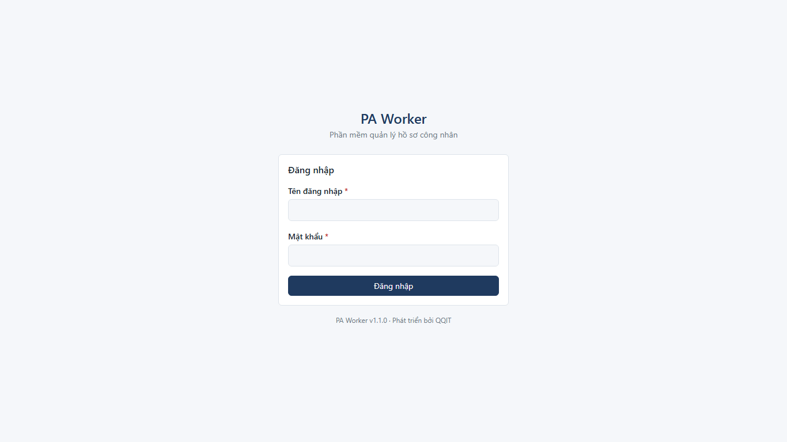

### Màn hình chính

- **Menu bên trái** chỉ hiện những mục bạn được dùng. Màn hình nhỏ: bấm nút **Menu** ở góc trên.
- **Ô tìm nhanh** ở thanh trên: gõ mã hồ sơ, mã nhân viên, họ tên (có dấu hoặc không dấu, ví dụ `nguyen van an`) hoặc số điện thoại rồi nhấn Enter.
- **Tổng quan (Dashboard):** 9 thẻ số liệu (bấm vào thẻ để mở danh sách đã lọc, số dòng đúng bằng số trên thẻ), biểu đồ, và **việc cần làm**: hồ sơ chờ duyệt, cần bổ sung, CCCD sắp hết hạn, đợt làm việc sắp đủ 12 tháng.

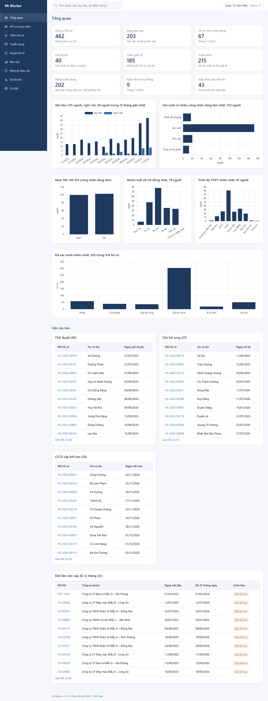

### Ba loại trạng thái

Mỗi hồ sơ có các nhãn màu riêng cho từng loại trạng thái:

| Loại | Các trạng thái |
| --- | --- |
| Xác minh hồ sơ | Nháp → Chờ duyệt → Đã xác minh; hoặc Cần bổ sung, Bị từ chối; cuối cùng Lưu trữ |
| Tuyển dụng (mỗi lần ứng tuyển) | Mới nộp, Đang sàng lọc, Hẹn phỏng vấn, Đạt, Không đạt, Ứng viên từ chối, Tạm hoãn |
| Làm việc (khi đã có mã nhân viên) | Chờ nhận việc, Thử việc, Đang làm việc, Đã nghỉ việc |

Tài liệu trong tab Tài liệu có thêm trạng thái xác minh riêng: Chưa xác minh, Đã đối chiếu bản gốc, Không hợp lệ.

### Tìm và lọc danh sách hồ sơ

Menu **Hồ sơ công nhân**: thanh lọc gồm phòng ban, bộ phận (có lựa chọn "Chưa có bộ phận"), chức danh, trình độ, công ty khách, ba loại trạng thái, thiếu giấy tờ, hoàn thiện, khoảng ngày. Bấm **Lọc**; **Xóa lọc** để bỏ. Danh sách 20 dòng mỗi trang; bộ lọc được giữ khi bạn quay lại.

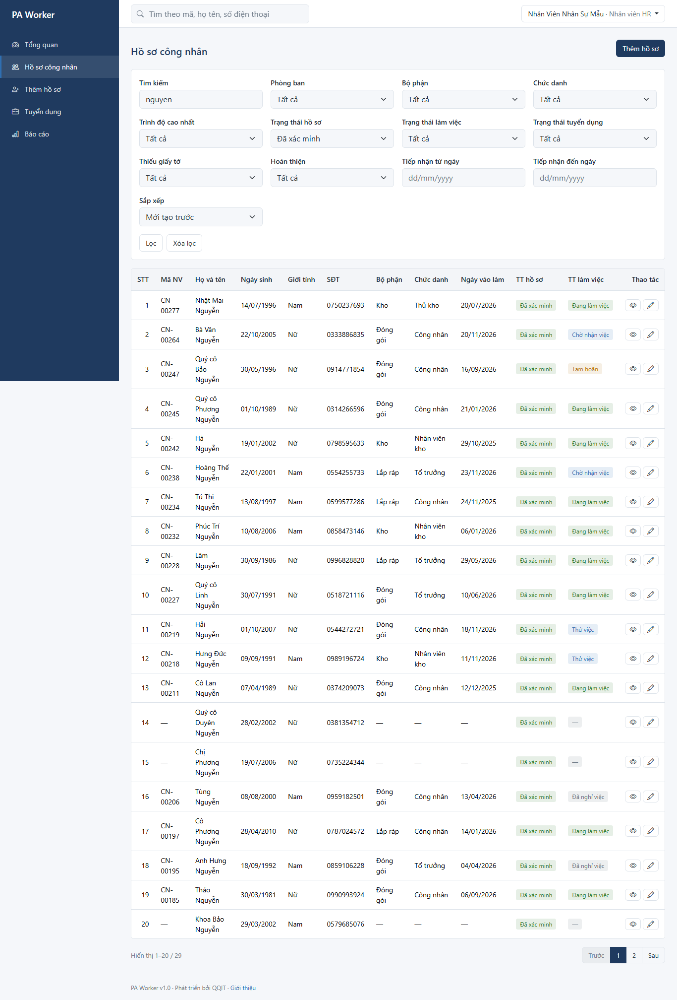

### Chi tiết hồ sơ

Hồ sơ có 5 tab: **Thông tin cá nhân**, **Tuyển dụng & CV**, **Quá trình làm việc**, **Tài liệu**, **Lịch sử thay đổi**. Số CCCD luôn hiện dạng che (`0791••••2345`).

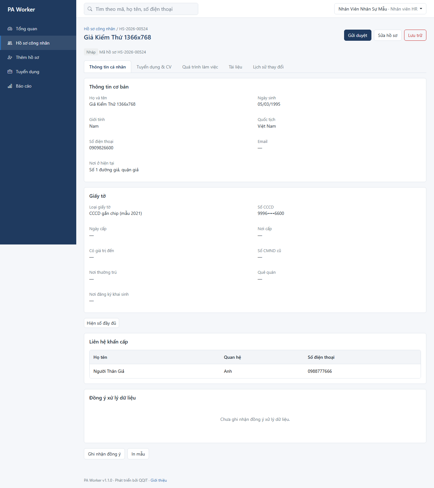

## Nhân viên HR

Việc chính: nhập hồ sơ, bổ sung giấy tờ, gửi duyệt, theo dõi tuyển dụng và quá trình làm việc.

### 1. Nhập hồ sơ từ ảnh CCCD và CV (cách nhanh nhất)

1. Menu **Thêm hồ sơ** → **Từ CCCD và CV**.
2. Chọn ảnh **mặt trước**, **mặt sau** CCCD (chụp rõ, đủ sáng, không lóa, ảnh rộng tối thiểu 1000 điểm ảnh) và tệp **CV** (PDF, Word, ảnh) nếu có. Mỗi tệp tối đa 10 MB. Bấm **Nhận diện**.
3. Màn hình đối chiếu hiện ảnh bên trái, thông tin máy đọc bên phải. Mỗi trường có nhãn nguồn: **QR** (đọc từ mã QR, tin cậy cao), **OCR** (đọc chữ trên ảnh), **Gợi ý**, **Nhập tay**.
4. **Trường tô vàng** là trường máy không chắc chắn: so với ảnh, sửa nếu sai, rồi tích **Đã kiểm tra**. Chưa tích hết thì nút **Lưu hồ sơ** không bấm được, và máy chủ cũng kiểm tra lại.
5. Ảnh nghiêng thì bấm **Xoay ảnh**; ảnh kém thì chụp lại.
6. CV: bôi đen một đoạn trong văn bản CV, bấm **Đưa vào trường…** để chép vào Kỹ năng, Học vấn, Kinh nghiệm…
7. Nhập số điện thoại rồi bấm **Lưu hồ sơ**. Hồ sơ được tạo ở trạng thái **Nháp** và có mã hồ sơ.

Nếu số CCCD đã có trong hệ thống, màn hình báo trùng và có nút **Mở hồ sơ cũ**: dùng nút này để cập nhật hồ sơ cũ, không tạo hồ sơ mới.

Kết quả máy đọc **không bao giờ tự lưu** khi bạn chưa bấm Lưu hồ sơ. Phiên bỏ dở tự xóa sau 24 giờ; bấm **Hủy phiên** để xóa ngay.

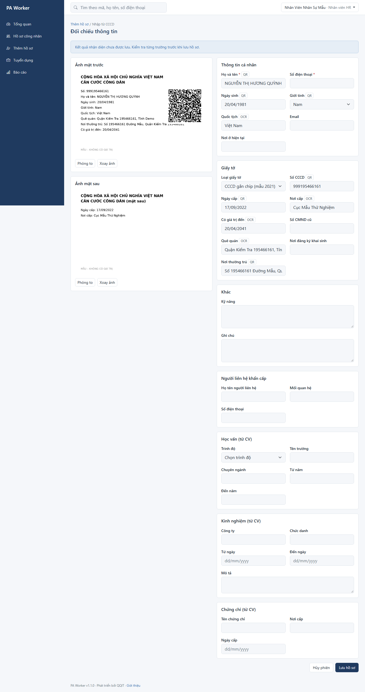

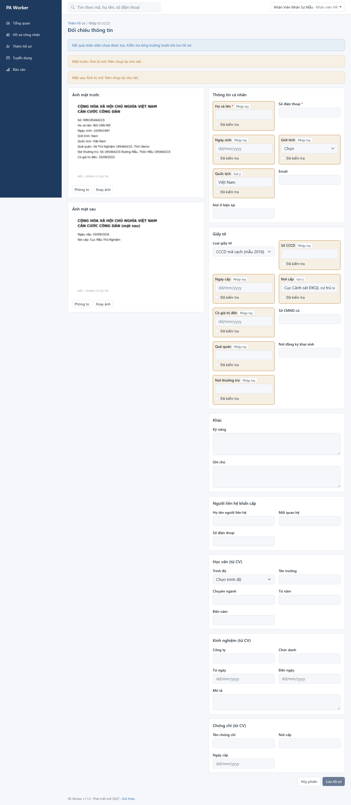

### 2. Nhập tay hoặc từ file Excel

- **Thêm hồ sơ → Nhập tay:** lưu Nháp chỉ cần họ tên và số điện thoại. Khi nhập số CCCD, hệ thống kiểm tra trùng ngay. Người dưới 15 tuổi bị chặn; từ 15 đến dưới 18 tuổi có cảnh báo.
- **Thêm hồ sơ → Từ file Excel:** bấm **Tải file Excel mẫu**, điền sheet "Hồ sơ", chọn tệp, bấm **Nhập hồ sơ**. Dòng đúng được nhập, dòng sai được liệt kê kèm lý do để sửa và nhập lại. Tối đa 1.000 dòng mỗi lần. HR chỉ nhập phần thông tin cá nhân; phần thông tin làm việc do Admin hoặc Quản lý nhập.

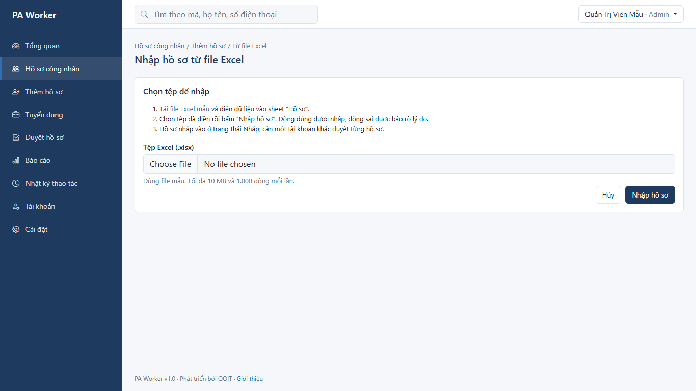

### 3. Bổ sung tài liệu, ghi nhận đồng ý, gửi duyệt

1. Tab **Tài liệu** → **Tải tài liệu lên**: chọn loại (CCCD mặt trước/sau, ảnh chân dung, CV, đơn xin việc, hợp đồng, bản cam kết…), chọn tệp. Chỉ nhận JPG, PNG, PDF, DOC, DOCX, tối đa 10 MB. Mục "còn thiếu" cho biết hồ sơ thiếu giấy tờ nào.
2. **Ghi nhận đồng ý** xử lý dữ liệu cá nhân: in mẫu văn bản đồng ý cho người lao động ký. Hình thức ký giấy thì phải tải bản ký lên.
3. Bấm **Gửi duyệt**. Hệ thống kiểm tra đủ trường bắt buộc (số định danh, ngày sinh, giới tính, liên hệ khẩn cấp, đồng ý xử lý dữ liệu); thiếu thì báo rõ thiếu gì.
4. Hồ sơ bị **Trả lại** (Cần bổ sung): đọc lý do ở tab Lịch sử thay đổi, bổ sung, rồi gửi duyệt lại.

Bạn **không tự duyệt** được hồ sơ do mình nhập hoặc mình gửi duyệt.

### 4. Tuyển dụng và quá trình làm việc

- Tab **Tuyển dụng & CV**: **Thêm lần ứng tuyển**; cập nhật trạng thái (Không đạt bắt buộc ghi lý do); thêm học vấn, chứng chỉ, kinh nghiệm.
- Khi lần ứng tuyển **Đạt** và hồ sơ **Đã xác minh**: bấm **Tiếp nhận vào làm** để cấp mã nhân viên tự động. Người quay lại làm giữ mã cũ.
- Tab **Quá trình làm việc**: **Ghi nhận thay đổi** (điều chuyển bộ phận, đổi chức danh, ca, trạng thái làm việc; lịch sử giữ dòng cũ), **Thêm hợp đồng**, **Thêm đợt làm việc** (công ty khách hàng, vị trí, ngày bắt đầu/kết thúc; mỗi lúc chỉ một công ty). HR xem được lịch sử lương nhưng không thêm lương.
- Menu **Tuyển dụng**: danh sách mọi lần ứng tuyển, lọc theo trạng thái, vị trí, nguồn, ngày.

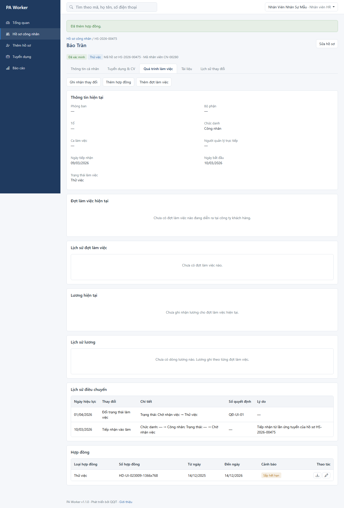

### 5. Xuất Excel, báo cáo, in

- Danh sách hồ sơ: bấm **Xuất Excel** để tải đúng danh sách đang lọc. Số CCCD trong file luôn được che.
- Menu **Báo cáo**: chọn loại báo cáo (theo phòng ban, giới tính, nhóm tuổi, trình độ, công ty khách…), bấm **In báo cáo** hoặc **Xuất Excel**.
- Mọi lần xuất, in, xem số CCCD đầy đủ, xem/tải tài liệu đều được ghi nhật ký.

### 6. Lưu trữ và mở lại

- **Lưu trữ** hồ sơ Nháp, Cần bổ sung, Bị từ chối không dùng nữa (có hộp xác nhận). HR không lưu trữ hồ sơ Đã xác minh.
- Người cũ quay lại làm: mở hồ sơ Lưu trữ, bấm **Mở lại hồ sơ**; hồ sơ về Nháp và có lần ứng tuyển mới.
- Hệ thống tự Lưu trữ: 30 ngày sau ngày nghỉ việc; 30 ngày sau kết quả Không đạt/Ứng viên từ chối; 30 ngày sau Bị từ chối; hồ sơ Nháp/Cần bổ sung không thay đổi trong 6 tháng.

## Quản lý nhân sự

Có mọi quyền của Nhân viên HR, và thêm các quyền sau.

### 1. Duyệt hồ sơ

1. Menu **Duyệt hồ sơ**: hàng đợi hồ sơ Chờ duyệt, cũ nhất ở trên.
2. Mở hồ sơ, đối chiếu thông tin với giấy tờ (tab Tài liệu), rồi chọn:
   - **Duyệt hồ sơ** → Đã xác minh;
   - **Trả lại** → Cần bổ sung (bắt buộc ghi lý do);
   - **Từ chối** → Bị từ chối (bắt buộc ghi lý do).
3. Ô lý do: **không ghi họ tên**, chỉ dùng mã hồ sơ.
4. Hồ sơ bạn tạo hoặc bạn gửi duyệt thì không duyệt được (dòng có ghi chú "Bạn không duyệt được hồ sơ này"); người khác phải duyệt.

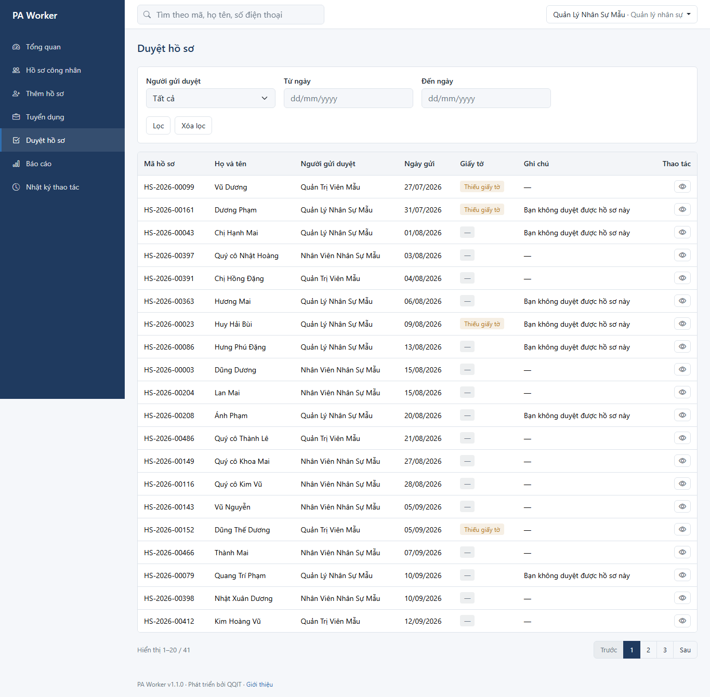

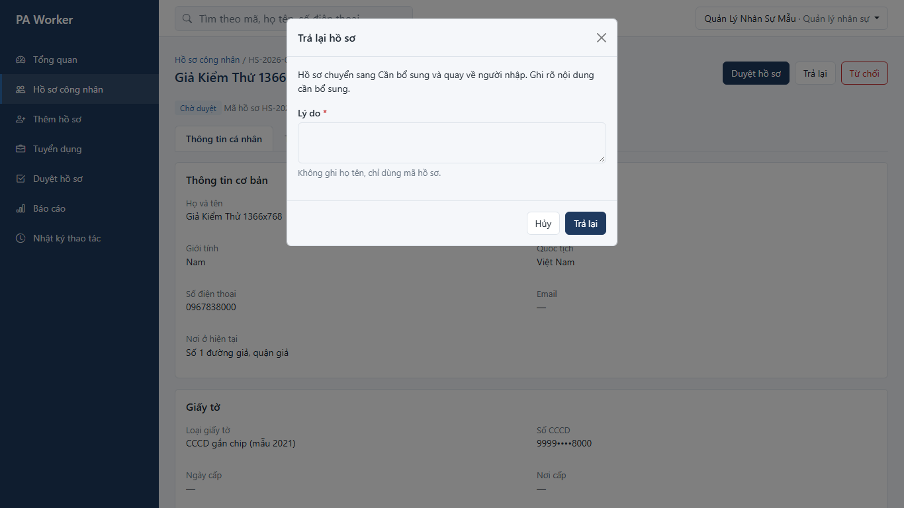

Sửa họ tên, ngày sinh hoặc số CCCD của hồ sơ Đã xác minh thì hồ sơ tự về **Chờ duyệt**.

### 2. Xác minh tài liệu

Tab **Tài liệu**: đổi trạng thái từng tài liệu thành **Đã đối chiếu bản gốc** hoặc **Không hợp lệ** sau khi xem bản gốc.

### 3. Lương và đơn giá

Tab **Quá trình làm việc** → đợt làm việc → **Thêm dòng lương**: lương tháng, đơn giá tháng cho công ty khách (được để trống), ngày áp dụng, lý do. Không sửa, không xóa dòng cũ; nhập sai thì thêm dòng mới. Chỉ Admin và Quản lý thêm lương; mọi vai trò xem được.

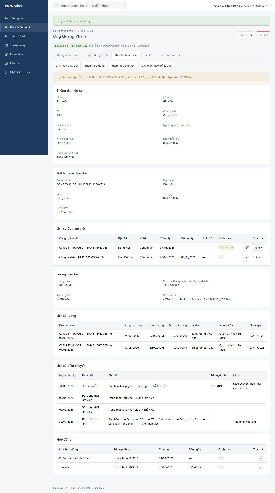

### 4. Lưu trữ hồ sơ đã xác minh, nhật ký, xuất CCCD đầy đủ

- Lưu trữ hồ sơ Đã xác minh: bắt buộc ghi lý do; bị chặn khi người đó đang Thử việc hoặc Đang làm việc.
- Menu **Nhật ký thao tác**: lọc theo người, mã hồ sơ, hành động, ngày; bấm biểu tượng mắt để xem giá trị trước/sau.
- Tab **Lịch sử thay đổi** của hồ sơ: xem chi tiết giá trị trước/sau từng trường.
- Danh sách hồ sơ: **Xuất Excel ▾** → **Xuất kèm số CCCD đầy đủ** (có hộp xác nhận, ghi nhật ký). Chỉ dùng khi thật cần.
- Nhập Excel cả phần thông tin làm việc (mã nhân viên cũ, bộ phận, công ty khách…).

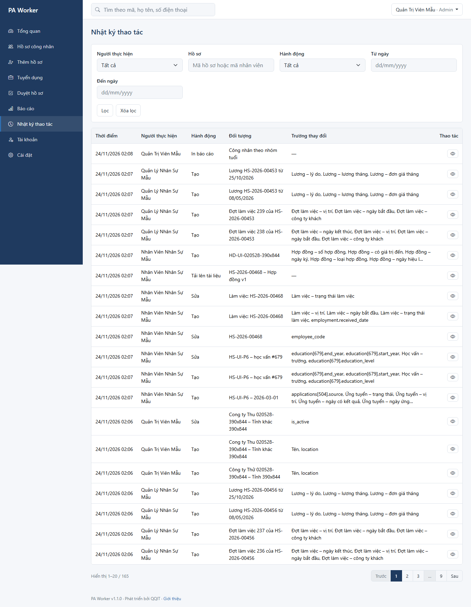

## Admin

Có mọi quyền của Quản lý nhân sự, và thêm các quyền sau.

### 1. Tài khoản

Menu **Tài khoản**:
- **Thêm tài khoản:** tên đăng nhập, họ tên, vai trò. Hệ thống hiện **mật khẩu tạm một lần**; giao cho người dùng trực tiếp (không gửi qua tin nhắn công khai). Lần đầu đăng nhập người đó phải đổi mật khẩu.
- **Khóa tài khoản** (người nghỉ việc, nghi lộ mật khẩu), **Mở khóa** (cả tài khoản khóa tạm do nhập sai), **Đặt lại mật khẩu** (người dùng quên mật khẩu).
- Admin không tự khóa và không tự đổi vai trò của chính mình. Hệ thống luôn phải còn ít nhất một Admin đang hoạt động.
- Tab **Lịch sử đăng nhập**: các lần đăng nhập thành công và thất bại.

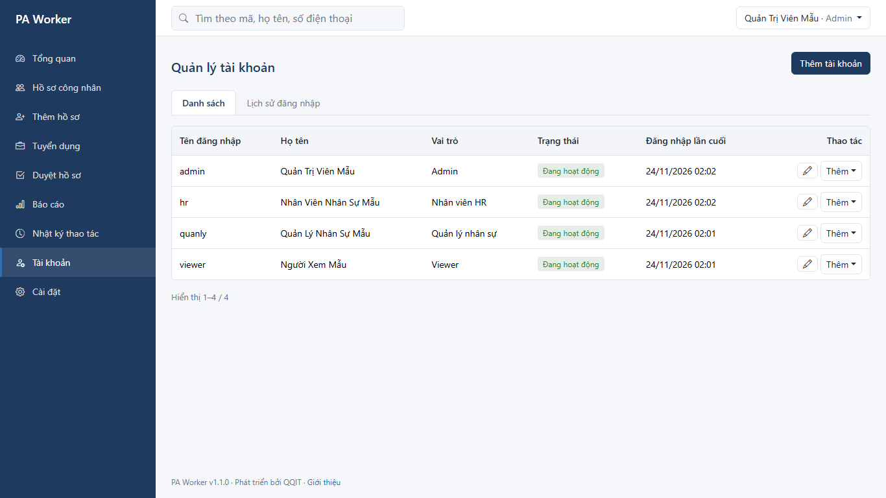

Admin quên mật khẩu của chính mình: xem [Xử lý sự cố](xu-ly-su-co.md#quên-mật-khẩu-admin).

### 2. Cài đặt

Menu **Cài đặt** có các tab:

| Tab | Dùng để |
| --- | --- |
| Danh mục | Phòng ban, bộ phận, tổ, chức danh, ca, nguồn ứng tuyển, trình độ, nhóm tài liệu, loại tài liệu, công ty khách hàng. Không xóa; dùng **Ngừng** thay cho xóa |
| Sinh mã | Tiền tố, năm, số chữ số của mã hồ sơ và mã nhân viên; xem trước mã kế tiếp. Mã đã cấp giữ nguyên |
| Ngưỡng và thời hạn | Số ngày cảnh báo sắp hết hạn; thời hạn lưu trữ (ứng viên không đạt 12 tháng, công nhân đã nghỉ 10 năm); số ngày tự Lưu trữ; thời hạn phiên nhận diện |
| OCR và QR | Ngưỡng tin cậy OCR; cấu hình QR từng mẫu thẻ (khi thử thẻ thật mà QR đọc sai thứ tự trường thì sửa ở đây). API OCR ngoài **tắt**, không bật (ảnh sẽ gửi ra Internet) |
| Chờ hủy | Hồ sơ Lưu trữ đã quá thời hạn lưu trữ: chọn rồi **Hủy hồ sơ đã chọn** (ẩn danh hóa: xóa dữ liệu cá nhân và tệp, giữ mã và nhật ký). Không hoàn tác được |
| Biên bản hủy | Biên bản mỗi lần hủy; xem và in |

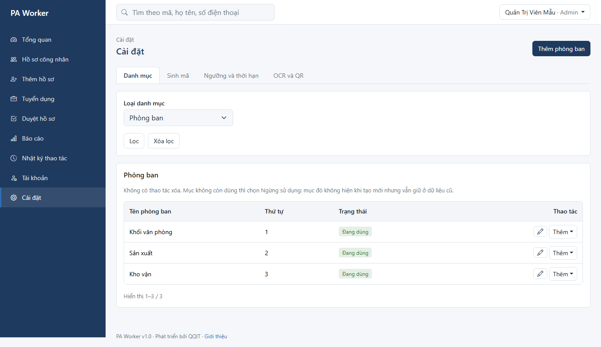

### 3. Ẩn danh hóa theo yêu cầu của người lao động

Khi người lao động có đơn yêu cầu xóa dữ liệu: chuyển hồ sơ sang **Lưu trữ** trước (nếu được), rồi bấm **Ẩn danh hóa theo yêu cầu**. Nhập lý do (không ghi họ tên), số/ngày đơn yêu cầu, gõ lại mã hồ sơ để xác nhận. Hệ thống sinh biên bản hủy. **Không hoàn tác được.**

### 4. Vận hành

- Theo dõi **sao lưu**: hệ thống tự sao lưu mỗi ngày; Admin kiểm tra bằng `Kiem tra.bat` và chép bản sao lưu ra ổ ngoài (xem [Hướng dẫn cài đặt, mục 9](huong-dan-cai-dat.md#9-sao-lưu)).
- Giữ USB khóa mã hóa ở nơi an toàn.
- Khi có người nghỉ việc: khóa tài khoản của họ.

## Viewer

Chỉ xem, không sửa:
- Xem Tổng quan, danh sách và chi tiết hồ sơ, Tuyển dụng, Báo cáo (xem trên màn hình).
- **Không thấy:** số CCCD đầy đủ (chỉ dạng che), số CMND cũ, địa chỉ thường trú, quê quán, ảnh CCCD. Không xem và không tải tài liệu.
- **Thấy:** số điện thoại, nơi ở hiện tại, lương và mức lương mong muốn.
- Không xuất Excel, không in báo cáo.

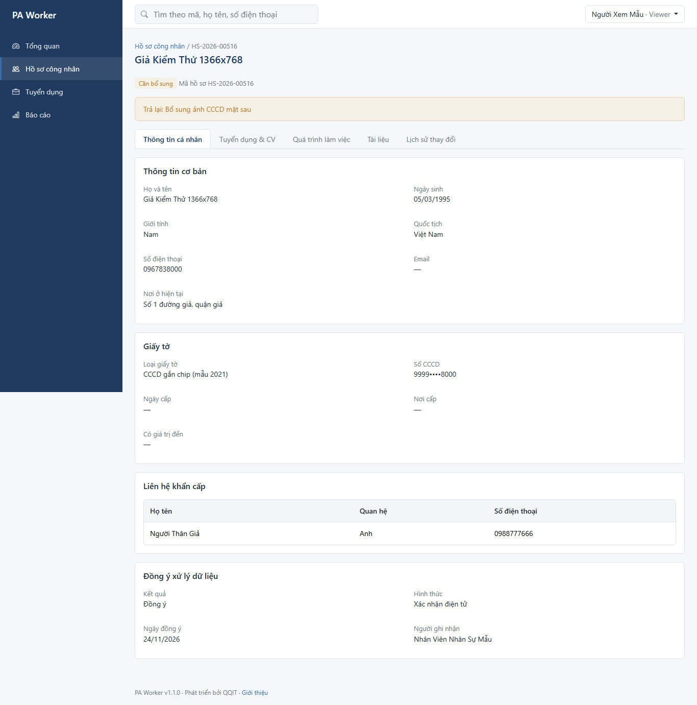

## Bảng quyền tóm tắt

| Việc | Admin | Quản lý | HR | Viewer |
| --- | --- | --- | --- | --- |
| Xem hồ sơ, Tổng quan, báo cáo | ✓ | ✓ | ✓ | ✓ (che trường nhạy cảm) |
| Thêm, sửa hồ sơ; nhập CCCD/CV/Excel; tải tài liệu | ✓ | ✓ | ✓ | |
| Gửi duyệt | ✓ | ✓ | ✓ | |
| Duyệt, trả lại, từ chối; xác minh tài liệu | ✓ | ✓ | | |
| Xem số CCCD đầy đủ (ghi nhật ký) | ✓ | ✓ | ✓ | |
| Xuất Excel, in báo cáo | ✓ | ✓ | ✓ | |
| Xuất kèm số CCCD đầy đủ | ✓ | ✓ | | |
| Thêm lương | ✓ | ✓ | | |
| Nhật ký thao tác, chi tiết giá trị trước/sau | ✓ | ✓ | | |
| Tài khoản, Cài đặt, hủy hồ sơ hết hạn, ẩn danh hóa theo yêu cầu | ✓ | | | |
