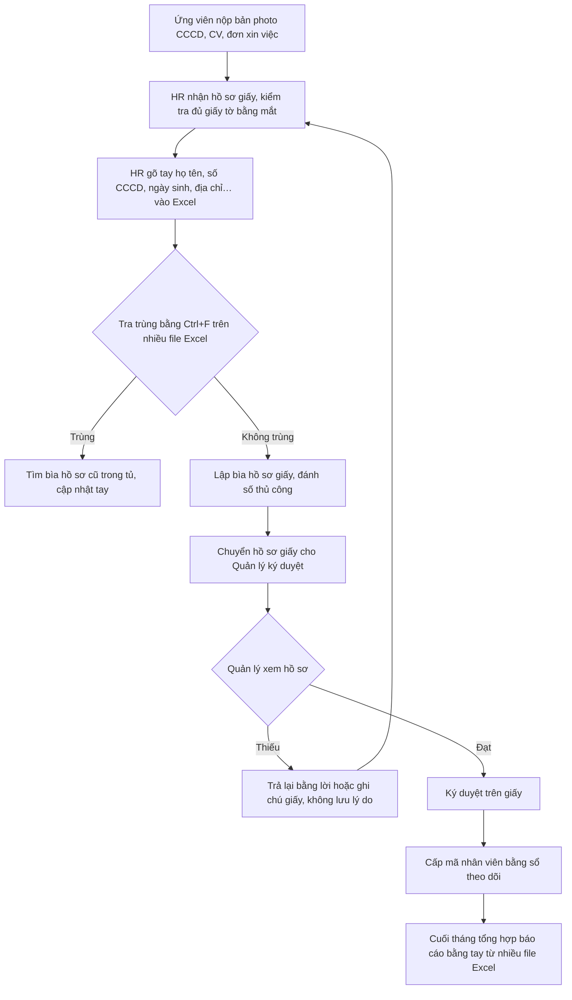
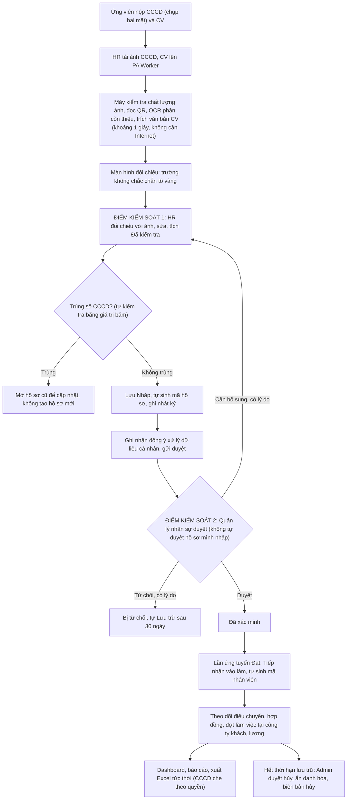

# Quy trình tiếp nhận hồ sơ công nhân: trước và sau khi có PA Worker

Tài liệu phục vụ chương nghiệp vụ của khóa luận (yêu cầu mục XI). Quy trình "sau" lấy theo phần mềm đã nghiệm thu (yêu cầu mục IX). Quy trình "trước" là mô tả điển hình cách làm thủ công bằng giấy và bảng tính **[Giả định]**; người viết khóa luận cần đối chiếu với cách làm thực tế tại doanh nghiệp khảo sát và sửa lại cho đúng.

## 1. Trước khi có phần mềm (thủ công) [Giả định]

Điểm yếu thường gặp:
- Gõ tay số CCCD 12 chữ số dễ sai; tra trùng thủ công dễ sót.
- Bản photo CCCD để trong tủ và trong file Excel không bảo vệ, ai mở được file thì xem được số định danh; không biết ai đã xem.
- Lý do trả lại, lịch sử sửa đổi không được ghi lại.
- Không biết hồ sơ nào đến hạn hủy theo thời hạn lưu trữ.
- Báo cáo mất nhiều thời gian và dễ lệch số giữa các file.

## 2. Sau khi có PA Worker

## 3. So sánh

| Khía cạnh | Trước [Giả định] | Sau (PA Worker) |
| --- | --- | --- |
| Nhập thông tin CCCD | Gõ tay toàn bộ | Máy đọc QR/OCR, HR chỉ đối chiếu trường tô vàng |
| Kiểm tra trùng | Tra thủ công trên nhiều file | Tự động theo số CCCD (giá trị băm), cảnh báo theo SĐT, họ tên + ngày sinh |
| Duyệt hồ sơ | Ký giấy, lý do không lưu | Trạng thái rõ ràng, lý do bắt buộc, không tự duyệt, lịch sử đầy đủ |
| Bảo vệ dữ liệu cá nhân | Bản photo và file Excel không kiểm soát | Mã hóa số định danh, che theo quyền, nhật ký mọi lần xem/tải/xuất, ghi nhận đồng ý |
| Thời hạn lưu trữ | Không theo dõi | Tự tính hạn, danh sách chờ hủy, ẩn danh hóa có biên bản |
| Báo cáo | Tổng hợp tay cuối tháng | Dashboard và báo cáo tức thời, số khớp danh sách |
| Sao lưu | Phụ thuộc cá nhân | Tự sao lưu mỗi ngày, file mã hóa, đã thử phục hồi |
