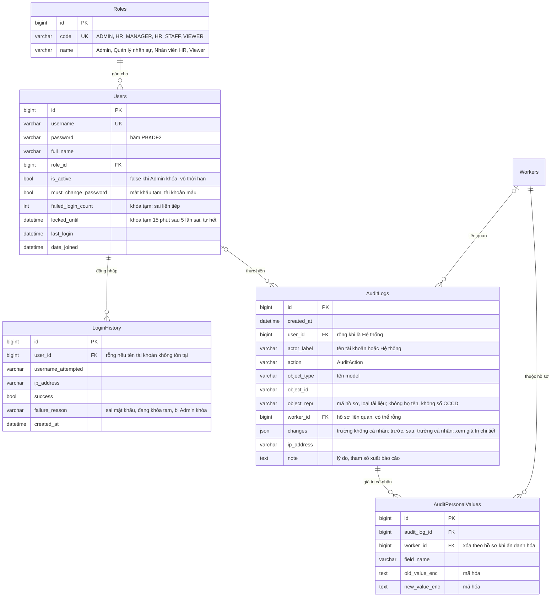

# Sơ đồ ERD – PA Worker

Phase 1 · Ngày 21/11/2026 · Cập nhật v1.1 ngày 23/11/2026 · Căn cứ: `docs/yeu-cau.md` mục VI, `docs/lam-ro-yeu-cau.md` câu 1–47 (câu 39–47 là phiếu thay đổi v1.1).

Tài liệu này là **nguồn gốc** cho `models.md` và `trang.md`: tên bảng, tên cột và quan hệ ở hai tài liệu đó phải khớp với tài liệu này.

## 1. Quy ước

- Tên bảng giữ đúng tên ở mục VI của yêu cầu (`Workers`, `LoginHistory`, `Settings`…) để dễ đối chiếu. Tên bảng thật trong CSDL do Django đặt (`<app>_<model>`), bảng ánh xạ ở `models.md`.
- Ký hiệu cột: `PK` khóa chính, `FK` khóa ngoại, `UK` duy nhất. Mọi bảng có `id bigint PK` trừ khi ghi khác.
- Cột có hậu tố `_enc`: **mã hóa khi lưu** (Fernet, khóa `FIELD_ENCRYPTION_KEY` trong `.env`).
- Cột có hậu tố `_hash`: HMAC-SHA256 của giá trị đã chuẩn hóa (khóa `HASH_KEY` riêng trong `.env`), dùng để kiểm tra trùng và tìm chính xác.
- Cột trạng thái lưu mã của `TextChoices` (danh sách giá trị ở `models.md` mục 2).
- Kiểu dữ liệu ghi theo nghĩa chung: `varchar`, `text`, `int`, `bigint`, `decimal`, `bool`, `date`, `datetime`, `json`, `uuid`, `file` (đường dẫn tệp trong kho riêng, không public).

## 2. Sơ đồ tổng quát (chỉ quan hệ)

```mermaid
erDiagram
    Roles ||--o{ Users : "gán cho"
    Users ||--o{ LoginHistory : "đăng nhập"
    Users |o--o{ AuditLogs : "thực hiện"
    Workers |o--o{ AuditLogs : "liên quan"
    AuditLogs ||--o{ AuditPersonalValues : "giá trị cá nhân"
    Workers ||--o{ AuditPersonalValues : "thuộc hồ sơ"

    Users ||--o{ Workers : "tạo"
    Workers ||--o| IdentityDocuments : "có"
    Workers ||--o{ IdentityFieldSources : "nguồn trường"
    Workers ||--o{ EmergencyContacts : "có"
    Workers ||--o{ DataConsents : "ghi nhận"
    Workers ||--o{ StatusChanges : "đổi trạng thái"
    Workers ||--o{ WorkerDocuments : "thư mục tài liệu"
    DocumentTypes ||--o{ WorkerDocuments : "phân loại"
    RequiredDocumentGroups |o--o{ DocumentTypes : "nhóm bắt buộc"
    WorkerDocuments |o--o{ DataConsents : "biên bản"
    AnonymizationRecords ||--|{ AnonymizationItems : "gồm"
    Workers ||--o| AnonymizationItems : "bị ẩn danh"
    Users ||--o{ IntakeSessions : "tạo phiên"

    Workers ||--o{ Applications : "ứng tuyển"
    Positions ||--o{ Applications : "vị trí"
    ApplicationSources ||--o{ Applications : "nguồn"
    Workers ||--o{ Education : "học vấn"
    EducationLevels ||--o{ Education : "trình độ"
    Workers ||--o{ Certificates : "chứng chỉ"
    Workers ||--o{ WorkExperiences : "kinh nghiệm"

    Workers ||--o| Employments : "làm việc hiện tại"
    Applications |o--o| Employments : "tiếp nhận từ"
    Sections ||--o{ Employments : "bộ phận"
    Teams |o--o{ Employments : "tổ"
    Positions ||--o{ Employments : "chức danh"
    Shifts |o--o{ Employments : "ca"
    Workers |o--o{ Employments : "quản lý trực tiếp"
    Workers ||--o{ EmploymentHistory : "lịch sử"
    Workers ||--o{ Contracts : "hợp đồng"
    WorkerDocuments |o--o{ Contracts : "tệp đính kèm"

    Workers ||--o{ WorkAssignments : "đợt làm việc"
    ClientCompanies ||--o{ WorkAssignments : "làm tại"
    Positions ||--o{ WorkAssignments : "vị trí"
    Workers ||--o{ SalaryHistory : "lịch sử lương"
    WorkAssignments ||--o{ SalaryHistory : "lương của đợt"
    Users ||--o{ SalaryHistory : "ghi"

    Departments ||--o{ Sections : "gồm"
    Sections ||--o{ Teams : "gồm"
```

`Settings`, `CodeSequences`, `QrFormats` là bảng cấu hình, không có khóa ngoại tới hồ sơ (xem 3d).

## 3. Sơ đồ chi tiết

Mỗi bảng chỉ khai báo cột ở **một** sơ đồ con; ở sơ đồ khác chỉ xuất hiện tên để nối quan hệ.

### 3a. Tài khoản và nhật ký

### 3b. Hồ sơ, giấy tờ, tài liệu, nhập liệu

```mermaid
erDiagram
    Users ||--o{ Workers : "tạo"
    Workers ||--o| IdentityDocuments : "có"
    Workers ||--o{ IdentityFieldSources : "nguồn trường"
    Users |o--o{ IdentityFieldSources : "xác nhận"
    Workers ||--o{ EmergencyContacts : "có"
    Workers ||--o{ DataConsents : "ghi nhận"
    WorkerDocuments |o--o{ DataConsents : "biên bản"
    Workers ||--o{ StatusChanges : "đổi trạng thái"
    Users |o--o{ StatusChanges : "thực hiện"
    Workers ||--o{ WorkerDocuments : "thư mục tài liệu"
    DocumentTypes ||--o{ WorkerDocuments : "phân loại"
    Users ||--o{ WorkerDocuments : "tải lên"
    WorkerDocuments |o--o| WorkerDocuments : "thay thế bản"
    Users ||--o{ AnonymizationRecords : "duyệt hủy"
    AnonymizationRecords ||--|{ AnonymizationItems : "gồm"
    Workers ||--o| AnonymizationItems : "bị ẩn danh"
    Users ||--o{ IntakeSessions : "tạo phiên"

    Workers {
        bigint id PK
        varchar worker_code UK "HS-2026-00123, sinh khi lưu Nháp lần đầu"
        varchar employee_code UK "CN-00456, rỗng đến khi tiếp nhận"
        varchar full_name "bắt buộc từ Nháp"
        varchar name_search "họ tên không dấu, chữ thường; có chỉ mục"
        date date_of_birth "bắt buộc khi gửi duyệt"
        varchar gender "Gender; bắt buộc khi gửi duyệt"
        varchar nationality "mặc định Việt Nam"
        varchar phone "10 chữ số; bắt buộc từ Nháp; có chỉ mục"
        varchar email
        varchar current_address "nơi ở hiện tại"
        text skills "Kỹ năng, câu 25"
        text note
        varchar verification_status "VerificationStatus"
        bigint created_by_id FK
        datetime created_at
        datetime updated_at "cả khi dữ liệu con đổi; dùng cho hồ sơ bỏ dở"
        datetime anonymized_at "khác rỗng khi đã ẩn danh hóa"
    }
    IdentityDocuments {
        bigint id PK
        bigint worker_id FK,UK "1-1 với hồ sơ"
        varchar id_doc_type "IdDocType: CCCD 2021, Căn cước 2024, CCCD 2016"
        text id_number_enc "số định danh 12 số, mã hóa"
        varchar id_number_hash UK "HMAC, kiểm tra trùng"
        text old_id_number_enc "số CMND cũ, mã hóa"
        date issue_date
        varchar issue_place
        date expiry_date
        varchar hometown "quê quán, mẫu cũ"
        varchar birth_registration_place "nơi đăng ký khai sinh, mẫu mới"
        text permanent_address_enc "nơi thường trú hoặc cư trú, mã hóa"
        datetime updated_at
    }
    IdentityFieldSources {
        bigint id PK
        bigint worker_id FK
        varchar field_name "ví dụ full_name, identity.id_number"
        varchar source "FieldSource: QR, OCR, Nhập tay"
        decimal confidence "0-100, chỉ với OCR"
        bool edited_by_user "người sửa giá trị máy đọc"
        bigint confirmed_by_id FK
        datetime confirmed_at
    }
    EmergencyContacts {
        bigint id PK
        bigint worker_id FK
        varchar full_name
        varchar relationship
        varchar phone
        int sort_order
    }
    DataConsents {
        bigint id PK
        bigint worker_id FK
        bool consented
        date consent_date
        varchar method "ConsentMethod: ký giấy, xác nhận điện tử"
        bigint document_id FK "tệp biên bản, WorkerDocuments"
        bigint recorded_by_id FK
        datetime recorded_at
    }
    StatusChanges {
        bigint id PK
        bigint worker_id FK
        varchar from_status "VerificationStatus"
        varchar to_status "VerificationStatus"
        text reason "bắt buộc: Cần bổ sung, Bị từ chối, Đã xác minh sang Lưu trữ; hệ thống tự điền không họ tên"
        bigint changed_by_id FK "rỗng khi Hệ thống"
        datetime changed_at
    }
    WorkerDocuments {
        bigint id PK
        bigint worker_id FK
        bigint document_type_id FK
        file stored_file "tên ngẫu nhiên, kho riêng; rỗng sau ẩn danh"
        varchar original_name
        varchar mime_type "theo chữ ký tệp thật"
        int size_bytes "tối đa 10 MB"
        int version "1, 2, 3 theo từng lần thay thế"
        bigint replaces_id FK "bản cũ bị thay"
        bool is_current "false khi đã bị thay"
        varchar verification_status "DocumentVerificationStatus"
        bigint verified_by_id FK
        datetime verified_at
        text note
        bigint uploaded_by_id FK
        datetime uploaded_at
    }
    AnonymizationRecords {
        bigint id PK
        varchar record_no UK "BBH-2026-001"
        varchar kind "AnonymizationKind: hết hạn lưu trữ, theo yêu cầu của chủ thể; mặc định hết hạn"
        varchar request_ref "số/ngày đơn yêu cầu; bắt buộc khi theo yêu cầu"
        bigint performed_by_id FK "Admin"
        datetime performed_at
        int worker_count
        text note "lý do; không ghi họ tên"
    }
    AnonymizationItems {
        bigint id PK
        bigint record_id FK
        bigint worker_id FK,UK "mỗi hồ sơ chỉ bị ẩn danh một lần"
        varchar worker_code "chụp lại mã tại thời điểm hủy"
        varchar employee_code
        varchar retention_basis "RetentionBasis: 6 căn cứ, câu 2"
        date retention_expired_on "NOT NULL; ngày hết hạn tính theo câu 2; với ẩn danh theo yêu cầu là ngày lẽ ra hết hạn (luôn có giá trị)"
    }
    IntakeSessions {
        uuid id PK "khó đoán, dùng trên URL"
        bigint created_by_id FK
        datetime created_at
        datetime expires_at "created_at + intake_ttl_hours"
        file front_image "kho riêng, không public"
        file back_image "kho riêng, không public"
        file cv_file "kho riêng, không public"
        text result_enc "JSON kết quả QR, OCR, văn bản CV; mã hóa Fernet"
    }
```

### 3c. Tuyển dụng, làm việc, hợp đồng

```mermaid
erDiagram
    Workers ||--o{ Applications : "ứng tuyển"
    Positions ||--o{ Applications : "vị trí"
    ApplicationSources ||--o{ Applications : "nguồn"
    Workers ||--o{ Education : "học vấn"
    EducationLevels ||--o{ Education : "trình độ"
    Workers ||--o{ Certificates : "chứng chỉ"
    Workers ||--o{ WorkExperiences : "kinh nghiệm"
    Workers ||--o| Employments : "làm việc hiện tại"
    Applications |o--o| Employments : "tiếp nhận từ"
    Sections ||--o{ Employments : "bộ phận"
    Teams |o--o{ Employments : "tổ"
    Positions ||--o{ Employments : "chức danh"
    Shifts |o--o{ Employments : "ca"
    Workers |o--o{ Employments : "quản lý trực tiếp"
    Workers ||--o{ EmploymentHistory : "lịch sử"
    Users ||--o{ EmploymentHistory : "ghi"
    Workers ||--o{ Contracts : "hợp đồng"
    WorkerDocuments |o--o{ Contracts : "tệp đính kèm"
    Workers ||--o{ WorkAssignments : "đợt làm việc"
    ClientCompanies ||--o{ WorkAssignments : "làm tại"
    Positions ||--o{ WorkAssignments : "vị trí"
    Users ||--o{ WorkAssignments : "ghi"
    Workers ||--o{ SalaryHistory : "lịch sử lương"
    WorkAssignments ||--o{ SalaryHistory : "lương của đợt"
    Users ||--o{ SalaryHistory : "ghi"

    Applications {
        bigint id PK
        bigint worker_id FK
        bigint position_id FK
        bigint source_id FK "ApplicationSources"
        date applied_date
        decimal expected_salary "mọi vai trò xem được từ v1.1 (câu 48)"
        date available_date "ngày có thể nhận việc"
        varchar status "RecruitmentStatus"
        datetime interview_at
        text interview_notes
        date result_date "ngày có kết quả: Đạt, Không đạt, Ứng viên từ chối"
        text reject_reason "bắt buộc khi Không đạt"
        bigint created_by_id FK
        datetime created_at
        datetime updated_at
    }
    Education {
        bigint id PK
        bigint worker_id FK
        bigint education_level_id FK
        varchar school_name
        varchar major
        int start_year
        int end_year
        text note
    }
    Certificates {
        bigint id PK
        bigint worker_id FK
        varchar name
        varchar issuer
        date issue_date
        date expiry_date
        text note
    }
    WorkExperiences {
        bigint id PK
        bigint worker_id FK
        varchar company_name
        varchar job_title
        date start_date
        date end_date
        text description
    }
    Employments {
        bigint id PK
        bigint worker_id FK,UK "1-1 với hồ sơ"
        bigint application_id FK,UK "lần ứng tuyển được tiếp nhận; rỗng khi nhập Excel"
        date received_date "ngày tiếp nhận"
        date start_date "ngày bắt đầu, ngày vào làm"
        bigint section_id FK "bộ phận, KHÔNG bắt buộc từ v1.1 (câu 48); rỗng thì chưa có phòng ban"
        bigint team_id FK "tổ, không bắt buộc; có tổ thì phải có bộ phận và tổ thuộc bộ phận đó"
        bigint position_id FK
        bigint shift_id FK
        bigint manager_id FK "Workers, không bắt buộc"
        varchar work_status "WorkStatus"
        date resign_date "bắt buộc khi Đã nghỉ việc"
        varchar resign_reason "ResignReason"
        text resign_note
        datetime created_at
        datetime updated_at
    }
    EmploymentHistory {
        bigint id PK
        bigint worker_id FK
        varchar change_type "EmploymentChangeType"
        date effective_date
        varchar decision_no "số quyết định"
        text reason
        bigint from_section_id FK
        bigint to_section_id FK
        bigint from_team_id FK
        bigint to_team_id FK
        bigint from_position_id FK
        bigint to_position_id FK
        bigint from_shift_id FK
        bigint to_shift_id FK
        bigint from_manager_id FK "Workers; thêm ở Phase 6 (câu 48)"
        bigint to_manager_id FK "Workers"
        varchar from_work_status "WorkStatus"
        varchar to_work_status "WorkStatus"
        bigint created_by_id FK "rỗng khi Hệ thống"
        datetime created_at
    }
    Contracts {
        bigint id PK
        bigint worker_id FK
        varchar contract_no UK
        varchar contract_type "ContractType"
        date signed_date
        date effective_date
        date expiry_date "bắt buộc trừ loại không xác định thời hạn"
        bigint document_id FK "WorkerDocuments loại Hợp đồng; hiển thị bản hiện hành"
        text note
        bigint created_by_id FK
        datetime created_at
    }
    WorkAssignments {
        bigint id PK
        bigint worker_id FK "công nhân phải có mã NV"
        bigint client_company_id FK "ClientCompanies"
        bigint position_id FK "Positions: vị trí tại công ty khách"
        date start_date "bắt buộc"
        date end_date "không bắt buộc; null = đang mở; UK (worker_id) khi null"
        text note "trường cá nhân: ghi nhật ký qua AuditPersonalValues"
        bigint created_by_id FK
        datetime created_at
        datetime updated_at
    }
    SalaryHistory {
        bigint id PK
        bigint assignment_id FK "bắt buộc: lương và đơn giá thuộc một đợt làm việc (câu 48)"
        bigint worker_id FK "= WorkAssignments.worker_id; giữ để xóa theo hồ sơ khi ẩn danh hóa và truy vấn"
        text monthly_salary_enc "lương tháng, VNĐ, mã hóa"
        text client_unit_price_enc "đơn giá tháng tính cho công ty khách, VNĐ, mã hóa; có thể rỗng"
        date effective_date "ngày áp dụng"
        text reason "lý do thay đổi"
        bigint created_by_id FK "người sửa"
        datetime created_at
    }
```

### 3d. Danh mục và cài đặt

```mermaid
erDiagram
    Departments ||--o{ Sections : "gồm"
    Sections ||--o{ Teams : "gồm"
    RequiredDocumentGroups |o--o{ DocumentTypes : "nhóm bắt buộc"
    Users |o--o{ Settings : "cập nhật"
    ClientCompanies ||--o{ WorkAssignments : "làm tại"

    Departments {
        bigint id PK
        varchar name UK
        int sort_order
        bool is_active "ngừng sử dụng thay cho xóa"
    }
    Sections {
        bigint id PK
        bigint department_id FK "UK cùng name"
        varchar name
        int sort_order
        bool is_active
    }
    Teams {
        bigint id PK
        bigint section_id FK "UK cùng name"
        varchar name
        int sort_order
        bool is_active
    }
    Positions {
        bigint id PK
        varchar name UK
        bool is_active
    }
    Shifts {
        bigint id PK
        varchar name UK
        varchar time_range "ví dụ 06:00-14:00"
        bool is_active
    }
    ApplicationSources {
        bigint id PK
        varchar name UK
        bool is_active
    }
    EducationLevels {
        bigint id PK
        varchar name UK
        int rank UK "số lớn là trình độ cao hơn"
        bool is_active
    }
    ClientCompanies {
        bigint id PK
        varchar name "UK cùng location"
        varchar location "tỉnh/thành; mỗi địa điểm một dòng (câu 39)"
        bool is_active "ngừng sử dụng thay cho xóa"
    }
    RequiredDocumentGroups {
        bigint id PK
        varchar name UK "CCCD mặt trước, CCCD mặt sau, Ảnh chân dung, CV hoặc Đơn xin việc"
        int sort_order
        bool is_active
    }
    DocumentTypes {
        bigint id PK
        varchar name UK
        varchar system_code UK "mã cố định cho loại hệ thống dùng, ví dụ PORTRAIT"
        bigint required_group_id FK "rỗng nếu không bắt buộc"
        int sort_order
        bool is_active
    }
    Settings {
        bigint id PK "luôn bằng 1"
        varchar worker_code_prefix "HS"
        bool worker_code_use_year "true"
        int worker_code_digits "5"
        varchar employee_code_prefix "CN"
        bool employee_code_use_year "false"
        int employee_code_digits "5"
        int expiry_warning_days "30; dùng chung cho CCCD, hợp đồng, đợt làm việc sắp đủ 12 tháng (câu 17, 43)"
        int assignment_limit_months "12; thời hạn một đợt làm việc để cảnh báo (câu 43)"
        int ocr_confidence_threshold "80"
        int failed_retention_months "12"
        int resigned_retention_years "10"
        int auto_archive_resigned_days "30"
        int auto_archive_failed_days "30"
        int stale_draft_months "6"
        int intake_ttl_hours "24"
        bool external_ocr_enabled "false"
        varchar external_ocr_url "khóa API nằm trong .env"
        text key_check_enc "chuỗi cố định mã hóa bằng FIELD_ENCRYPTION_KEY; ghi một lần ở lần khởi động đầu, không sửa"
        varchar key_check_hash "HMAC chuỗi cố định bằng HASH_KEY; ghi một lần ở lần khởi động đầu, không sửa"
        bigint updated_by_id FK
        datetime updated_at
    }
    CodeSequences {
        bigint id PK
        varchar code_type "WORKER, EMPLOYEE; UK cùng year"
        int year "0 khi mã không có năm"
        int last_number "chỉ tăng, không bao giờ giảm"
    }
    QrFormats {
        bigint id PK
        varchar id_doc_type UK "IdDocType có QR: CCCD 2021, Căn cước 2024"
        varchar separator "mặc định dấu |"
        json field_order "danh sách tên trường theo thứ tự"
        varchar date_format "ddmmyyyy"
        bool is_active
        datetime updated_at
    }
```

## 4. Bảng so với mục VI

Mục VI liệt kê 24 bảng và nhắc tới 2 bảng danh mục qua khóa ngoại (`ApplicationSources`, `EducationLevels`). Cả 26 bảng đều có trong sơ đồ.

**Bảng thêm** (mục VI cho phép điều chỉnh kèm lý do):

| Bảng | Lý do |
| --- | --- |
| `RequiredDocumentGroups` | Câu 4: hồ sơ đủ giấy tờ khi mỗi nhóm bắt buộc có ít nhất một tài liệu hợp lệ; nhóm cấu hình được |
| `IdentityFieldSources` | Mục V: lưu nguồn từng trường (QR/OCR/Nhập tay), độ tin cậy, trường người sửa, ai xác nhận. Tách bảng để đạt 3NF thay vì nhồi vào `IdentityDocuments`; nối vào `Workers` vì họ tên, ngày sinh, giới tính, quốc tịch nằm ở `Workers` |
| `CodeSequences` | Bộ đếm mã hồ sơ và mã NV, khóa dòng khi cấp mã; chỉ tăng nên không cấp lại mã cũ (câu 6), và được đẩy lên số lớn nhất khi nhập mã NV cũ từ Excel (câu 27) |
| `QrFormats` | Câu 20: thứ tự trường và ký tự phân cách QR cấu hình theo từng mẫu thẻ, không hard-code |
| `IntakeSessions` | Mục V: kết quả QR/OCR/CV chưa được HR xác nhận thì không được ghi vào `Workers`. Bảng này giữ tạm (xem mục 6) |
| `AnonymizationRecords`, `AnonymizationItems` | Câu 2, 38: mỗi lần hủy (ẩn danh hóa hết hạn hoặc theo yêu cầu của chủ thể) sinh biên bản ghi loại, ai, khi nào, những hồ sơ nào |
| `AuditPersonalValues` | Câu 30: giá trị trước/sau của trường cá nhân tách khỏi `AuditLogs` và mã hóa, để ẩn danh hóa xóa được mà `AuditLogs` vẫn chỉ thêm |

**Bảng thêm theo phiếu thay đổi v1.1** (câu 39–42, 44; 3 bảng, nâng tổng lên 37):

| Bảng | Lý do |
| --- | --- |
| `ClientCompanies` | Câu 39: danh mục công ty khách hàng, chỉ tên + địa điểm, mỗi địa điểm một dòng, ngừng sử dụng thay cho xóa |
| `WorkAssignments` | Câu 40: đợt làm việc của công nhân tại một công ty khách; mỗi lúc một công ty; giữ lịch sử. Tách khỏi `Employments` vì `Employments` là quan hệ lao động với bên cung ứng (1 dòng/người), còn đợt là quan hệ 1-nhiều theo thời gian |
| `SalaryHistory` | Câu 41, 42, 48: lịch sử lương tháng và đơn giá tháng của từng đợt làm việc, chỉ thêm, cột mã hóa, xóa khi ẩn danh hóa |

`Employments` giữ nguyên là quan hệ lao động với bên cung ứng (ngày bắt đầu, trạng thái làm việc, ngày nghỉ việc = ngày chấm dứt hợp đồng lao động, câu 44). **Bộ phận (`Sections`), Tổ (`Teams`), Ca (`Shifts`), Phòng ban (`Departments`) nội bộ giữ nguyên trong v1.1** (quyết định 23/11/2026, câu 48), vì yêu cầu v1.0 còn dùng chúng cho bộ lọc, Dashboard và báo cáo; chúng mô tả bộ phận nội bộ của bên cung ứng, còn nơi làm việc thực tế là `WorkAssignments`. **`Employments.section_id` đổi thành không bắt buộc** (cột nullable; migration ở Phase 6).

**Điều chỉnh:**

| Mục VI | Thiết kế | Lý do |
| --- | --- | --- |
| `Employments → Teams` | `Employments → Sections` (**không bắt buộc từ v1.1**) và `→ Teams` (không bắt buộc) | Câu 15 (sửa bởi câu 48): bộ phận và tổ đều không bắt buộc; có tổ thì phải có bộ phận; phòng ban suy ra từ bộ phận, chưa có bộ phận thì nhóm "Chưa có bộ phận" ở báo cáo |
| — | `Employments.manager_id → Workers` | Câu 15: người quản lý trực tiếp là một hồ sơ khác |
| — | `Employments.application_id → Applications` | Câu 7: biết lần ứng tuyển nào được tiếp nhận |
| `Settings` (chung chung) | Một dòng duy nhất, các cột cụ thể | Quy tắc mã, ngưỡng, thời hạn lưu trữ, cấu hình OCR có kiểu rõ ràng, dễ kiểm tra |
| `Users` gồm cả Admin Django | `Users` kế thừa tài khoản Django | Dùng sẵn băm mật khẩu và phiên đăng nhập; cột `is_staff`, `is_superuser`, `first_name`, `last_name`, `email` của Django giữ nguyên nhưng không dùng trong nghiệp vụ |

**Một cột tính sẵn:** `Workers.name_search` (họ tên bỏ dấu, chữ thường) lặp lại thông tin của `full_name`. Lý do: tìm không dấu phải chạy được trên cả PostgreSQL lẫn SQLite (bản dự phòng không Docker) và dưới 2 giây với 500 hồ sơ. Giá trị luôn được tính lại khi lưu, không cho sửa tay.

**Không lưu riêng, chỉ tính:** đợt làm việc hiện tại (đợt có `start_date` ≤ hôm nay và `end_date` rỗng hoặc ≥ hôm nay), mức lương và đơn giá hiện tại của đợt (dòng `SalaryHistory` của đợt có `effective_date` lớn nhất không quá hôm nay), đợt sắp đủ 12 tháng (chuỗi đợt liền nhau cùng **tên** công ty khách, bỏ qua địa điểm, tên so không phân biệt hoa thường và khoảng trắng thừa, giữ dấu; đợt sau bắt đầu không quá 1 ngày sau khi đợt trước kết thúc; `start_date` của đợt đầu chuỗi + `assignment_limit_months` nằm trong `expiry_warning_days` ngày tới; **không có trạng thái đợt làm việc**, không tạo bộ trạng thái thứ năm), ảnh chân dung (là `WorkerDocuments` có loại `PORTRAIT`, câu 4), phòng ban (từ bộ phận), thiếu giấy tờ / hoàn thiện / sắp hết hạn, ngày chuyển Lưu trữ và người gửi duyệt (từ `StatusChanges`), hạn lưu trữ (theo 6 căn cứ ở câu 2: từ `Employments.resign_date`, `Applications.result_date`, hoặc ngày chuyển Lưu trữ trong `StatusChanges`; hồ sơ Lưu trữ luôn tính được).

## 5. Ràng buộc

### Duy nhất
| Bảng | Cột |
| --- | --- |
| `Workers` | `worker_code`; `employee_code` (cho phép nhiều dòng rỗng) |
| `IdentityDocuments` | `worker_id`; `id_number_hash` (cho phép rỗng) |
| `Users` | `username` |
| `Roles` | `code` |
| `Employments` | `worker_id`; `application_id` |
| `Contracts` | `contract_no` |
| `ClientCompanies` | (`name`, `location`) |
| `WorkAssignments` | `worker_id` **có điều kiện** `end_date IS NULL` (mỗi công nhân tối đa một đợt đang mở; ràng buộc một phần, chạy được trên PostgreSQL và SQLite) |
| `AnonymizationRecords` | `record_no` |
| `AnonymizationItems` | `worker_id` |
| `CodeSequences` | (`code_type`, `year`) |
| `QrFormats` | `id_doc_type` |
| `IdentityFieldSources` | (`worker_id`, `field_name`) |
| Danh mục phẳng | `name` (Departments, Positions, Shifts, ApplicationSources, EducationLevels, RequiredDocumentGroups, DocumentTypes) |
| `Sections` / `Teams` | (`department_id`, `name`) / (`section_id`, `name`) |
| `EducationLevels` | `rank` |
| `DocumentTypes` | `system_code` (cho phép rỗng) |

Mã đã cấp không bao giờ cấp lại cho người khác, kể cả sau ẩn danh hóa: `worker_code`, `employee_code` không bị xóa khi ẩn danh; `CodeSequences.last_number` chỉ tăng; bộ sinh mã kiểm tra mã chưa tồn tại trước khi cấp, tồn tại thì tăng tiếp (câu 27). `employee_code` nhận mã cũ từ Excel: tối đa 20 ký tự, chữ/số/gạch ngang.

### Mã hóa và băm
- Mã hóa: `IdentityDocuments.id_number_enc`, `old_id_number_enc`, `permanent_address_enc`; `SalaryHistory.monthly_salary_enc`, `client_unit_price_enc` (câu 41); `IntakeSessions.result_enc`; `AuditPersonalValues.old_value_enc`, `new_value_enc`; `Settings.key_check_enc`.
- Băm: `IdentityDocuments.id_number_hash`; `Settings.key_check_hash`. Hai khóa khác nhau: lộ khóa băm không giải mã được dữ liệu, và dùng HMAC có khóa nên không dò ngược được từ 12 chữ số.
- Hai khóa sinh một lần khi cài, không nằm trong file sao lưu; thiếu khóa thì ứng dụng không khởi động (câu 31, `kien-truc.md`).
- `AuditLogs.changes` không bao giờ chứa giá trị của trường cá nhân: chỉ ghi tên trường và "(xem giá trị chi tiết)"; giá trị nằm ở `AuditPersonalValues` (câu 30). `AuditLogs.object_repr` và lý do hệ thống tự điền ở `StatusChanges.reason` chỉ dùng mã hồ sơ, không họ tên.

### Không xóa cứng
- Danh mục: `is_active = false` (ngừng sử dụng). Mục đã dùng không xóa được.
- `Workers`: không xóa; đóng bằng trạng thái Lưu trữ; hủy theo câu 2 là **ẩn danh hóa** (`anonymized_at`): xóa giá trị cá nhân, xóa tệp, giữ dòng, mã và nhật ký.
- `WorkerDocuments`: thay thế thì giữ bản cũ (`is_current = false`).
- `Users`: khóa bằng `is_active = false`.
- `ClientCompanies`: `is_active = false` (ngừng sử dụng); công ty đã có đợt làm việc không xóa được. `WorkAssignments`: không xóa; đợt kết thúc bằng `end_date`, nhập sai thì sửa (giá trị cũ ghi nhật ký).
- `SalaryHistory`: **chỉ thêm**, không sửa, không xóa dòng cũ (model chặn, PostgreSQL có trigger chặn `UPDATE`). Ngoại lệ duy nhất: xóa toàn bộ dòng của hồ sơ khi ẩn danh hóa (câu 41, `models.md` 4.7); cần thêm vào danh sách ngoại lệ của `CLAUDE.md`.
- `AuditLogs`, `LoginHistory`, `StatusChanges`, `EmploymentHistory`: **chỉ thêm**. Ứng dụng chặn sửa/xóa ở model; CSDL PostgreSQL có trigger chặn `UPDATE`/`DELETE` trên `AuditLogs`.
- `AuditPersonalValues`: không sửa (trigger chặn `UPDATE`); chỉ bị xóa khi ẩn danh hóa hồ sơ tương ứng, kèm một dòng `AuditLogs` `ANONYMIZE` (câu 30, 38).
- Bản ghi được xóa cứng: `IntakeSessions` (bản ghi tạm, không có bảng nào trỏ tới, xem mục 6) và `AuditPersonalValues` khi ẩn danh hóa (trên).

### Kiểm tra ở tầng ứng dụng (không biểu diễn được bằng khóa)
- `Employments.team_id` (nếu có) phải thuộc `section_id`; có `team_id` thì phải có `section_id` (`section_id` không bắt buộc).
- `WorkAssignments`: `end_date >= start_date`; các đợt của một công nhân không chồng lấn ngày (kiểm tra trong service, khóa dòng `Workers` khi ghi); công nhân phải có `Employments` và chưa Đã nghỉ việc; công ty và vị trí đang dùng (`is_active`) khi tạo mới.
- `SalaryHistory`: `worker_id` phải bằng `assignment.worker_id`; `effective_date` nằm trong khoảng ngày của đợt (từ `start_date`, đến `end_date` nếu có); sửa ngày của đợt không được làm dòng lương nằm ngoài khoảng; `monthly_salary` là số nguyên VNĐ > 0; `client_unit_price` (nếu có) là số nguyên VNĐ > 0; `reason` bắt buộc; chỉ Admin, Quản lý nhân sự được thêm (câu 42).
- `Applications.reject_reason` bắt buộc khi Không đạt; `Employments.resign_date`, `resign_reason` bắt buộc khi Đã nghỉ việc.
- `Contracts.expiry_date` bắt buộc trừ loại không xác định thời hạn; `expiry_date > effective_date`.
- `IdentityDocuments.issue_date > Workers.date_of_birth`.
- `StatusChanges.reason` bắt buộc với: Chờ duyệt → Cần bổ sung, Chờ duyệt → Bị từ chối, Đã xác minh → Lưu trữ thủ công (câu 9).
- `Contracts.document` luôn hiển thị bản hiện hành: đi theo chuỗi `WorkerDocuments.replaces` tới bản `is_current` (câu 32).
- `Applications.expected_salary`: từ v1.1 Viewer xem được (câu 48, sửa câu 13); file xuất vẫn không có cho Viewer (câu 18).

## 6. Bảng tạm `IntakeSessions`

- Mỗi lần HR nhập từ CCCD/CV tạo một phiên. Ảnh CCCD và tệp CV của phiên lưu trong **kho tệp riêng ngoài thư mục public**, tên ngẫu nhiên, giống `WorkerDocuments`; chỉ người tạo phiên (và Admin) mở được qua view có kiểm tra quyền.
- Kết quả QR, OCR, độ tin cậy, văn bản CV lưu ở `result_enc`: JSON **mã hóa Fernet**, vì chứa số CCCD và địa chỉ.
- Phiên kết thúc theo một trong ba cách, và cả ba đều **xóa dòng phiên, `result_enc` và mọi tệp còn lại của phiên**:
  1. **HR lưu hồ sơ:** ghi `Workers`, `IdentityDocuments`, `IdentityFieldSources`; ảnh CCCD và CV mà HR chọn giữ được chuyển thành `WorkerDocuments` (loại CCCD mặt trước / mặt sau / CV) của hồ sơ; sau đó xóa phiên ngay trong cùng giao dịch.
  2. **HR hủy phiên:** xóa ngay.
  3. **Bỏ dở:** lệnh `run_daily_jobs` xóa các phiên có `expires_at` đã qua. Thời hạn mặc định 24 giờ, cấu hình ở `Settings.intake_ttl_hours`.
- Nhật ký ghi việc tạo, lưu, hủy, hết hạn phiên (không ghi nội dung nhận diện).
