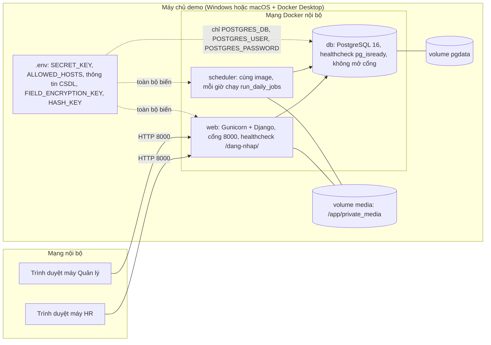
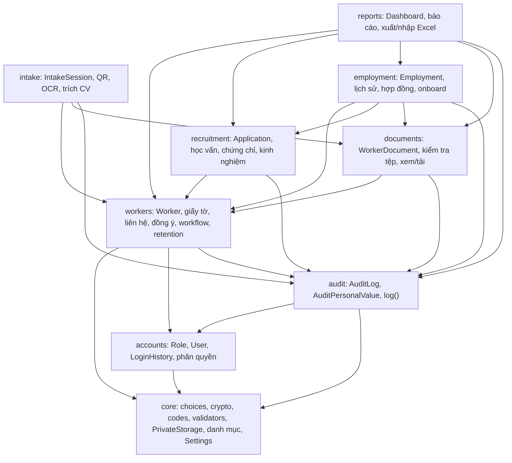
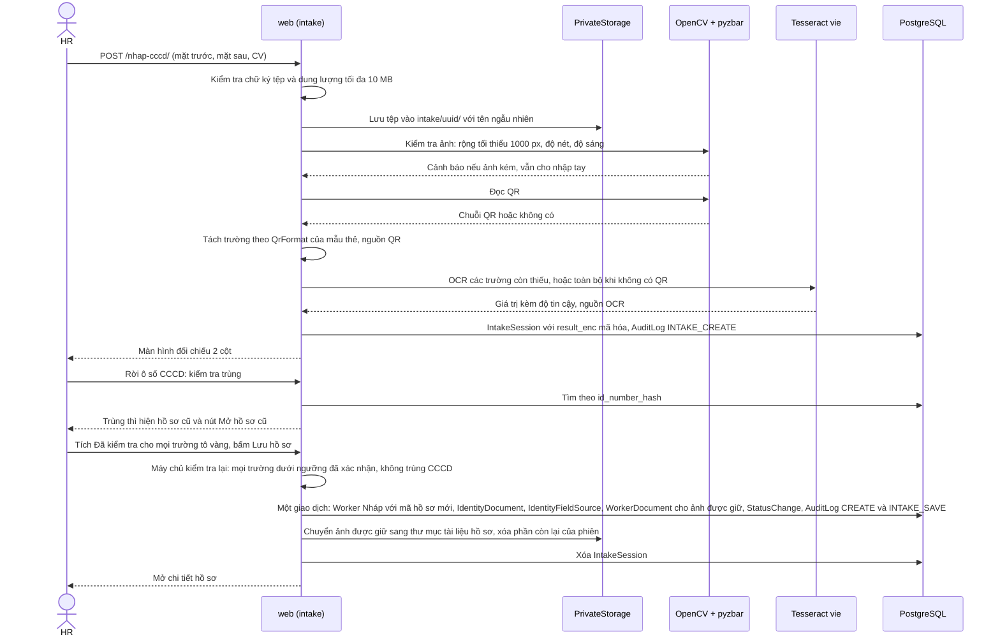
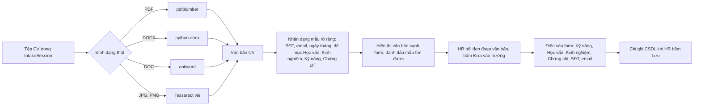
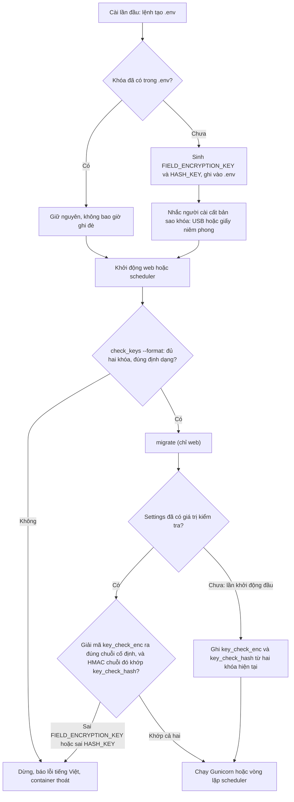

# Kiến trúc hệ thống – PA Worker

Phase 1 · Ngày 21/11/2026 · Dựa trên `docs/thiet-ke/erd.md`, `models.md`, `trang.md` và `docs/lam-ro-yeu-cau.md` câu 1–38.

## 1. Tổng quan

- Một web app Django chạy cục bộ trên **một máy tính** bằng Docker Compose. Các máy khác trong mạng nội bộ dùng trình duyệt truy cập `http://<IP máy chủ>:8000`.
- Mọi chức năng bắt buộc chạy **offline**: đọc QR, OCR, trích CV, xuất Excel đều xử lý ngay trên máy. Không gọi dịch vụ Internet, không dùng CDN (thư viện giao diện nằm trong `static/vendor/`).
- Ba container: `web` và `scheduler` dùng chung một image ứng dụng, cộng `db` (PostgreSQL).

## 2. Sơ đồ triển khai



Thứ tự khởi động: `db` khỏe (`pg_isready`) → `web` kiểm tra khóa, `migrate`, chạy Gunicorn, khỏe (`/dang-nhap/` trả 200) → `scheduler` bắt đầu vòng lặp.

| Thành phần | Nội dung |
| --- | --- |
| `web` | Image Python 3.12, cài sẵn `tesseract-ocr`, `tesseract-ocr-vie`, `libzbar0`, `antiword`. Khi khởi động: `check_keys --format` → `migrate` → `check_keys` (giá trị kiểm tra, mục 7) → Gunicorn. Tệp tĩnh `collectstatic` lúc build, phục vụ bằng WhiteNoise |
| Gunicorn | `--workers 3 --timeout 120`. Lý do: OCR và trích CV chạy **đồng bộ** trong request; trên máy demo yếu một lần OCR có thể mất vài chục giây, timeout mặc định 30 giây sẽ cắt ngang. 3 worker đủ cho 5–10 người dùng mà không chiếm quá nhiều RAM (mỗi worker nạp OpenCV); máy yếu có thể giảm còn 2 |
| `scheduler` | Cùng image với `web`, không mở cổng. Chỉ khởi động khi `web` đã khỏe (nghĩa là `migrate` đã xong). Vòng lặp `run_scheduler`: `check_keys` → `migrate --check` (còn migration chưa áp dụng thì chờ 60 giây rồi thử lại, không chạy tác vụ) → `run_daily_jobs` → nghỉ 1 giờ |
| `db` | PostgreSQL 16, chỉ nằm trong mạng Docker nội bộ, **không** khai báo `ports`. Chỉ nhận ba biến `POSTGRES_DB`, `POSTGRES_USER`, `POSTGRES_PASSWORD`; **không** nhận khóa mã hóa hay `SECRET_KEY` |
| `restart` | Cả ba service `restart: unless-stopped`: máy khởi động lại hoặc container lỗi thì tự chạy lại, trừ khi người dùng chủ động dừng |
| Volume `pgdata` | Dữ liệu CSDL; dựng lại container không mất dữ liệu |
| Volume `media` | Gắn vào `/app/private_media` của `web` và `scheduler`: tài liệu hồ sơ, ảnh và CV của phiên nhận diện. **Không** có URL công khai; chỉ tải qua view kiểm tra quyền |
| `.env` | Không commit; có `.env.example` mẫu. Chứa `SECRET_KEY`, `ALLOWED_HOSTS`, `POSTGRES_DB`, `POSTGRES_USER`, `POSTGRES_PASSWORD`, `FIELD_ENCRYPTION_KEY`, `HASH_KEY`, `EXTERNAL_OCR_API_KEY` (để trống, tính năng tắt mặc định) |
| `ALLOWED_HOSTS` | `settings.py` đọc từ biến `ALLOWED_HOSTS` trong `.env` (danh sách cách nhau bằng dấu phẩy), mặc định `localhost,127.0.0.1`. Muốn máy khác trong LAN truy cập thì thêm IP máy chủ, ví dụ `localhost,127.0.0.1,192.168.1.20` (mục 2.2) |
| HTTPS | Không có trong bản demo (ghi rõ trong hướng dẫn cài đặt). Khi triển khai thật thêm container Caddy hoặc Nginx làm reverse proxy |

Phác thảo `docker-compose.yml` (bản thật viết ở Phase 2):

```yaml
services:
  db:
    image: postgres:16
    restart: unless-stopped
    environment:                      # chỉ 3 biến; Compose lấy giá trị từ .env
      POSTGRES_DB: ${POSTGRES_DB}
      POSTGRES_USER: ${POSTGRES_USER}
      POSTGRES_PASSWORD: ${POSTGRES_PASSWORD}
    volumes: [pgdata:/var/lib/postgresql/data]
    healthcheck:
      test: ["CMD-SHELL", "pg_isready -U $${POSTGRES_USER} -d $${POSTGRES_DB}"]
      interval: 5s
      retries: 20
    # không có "ports": chỉ web và scheduler truy cập được

  web:
    build: .
    restart: unless-stopped
    env_file: .env
    depends_on:
      db: {condition: service_healthy}
    ports: ["8000:8000"]
    volumes: [media:/app/private_media]
    # entrypoint: check_keys --format -> migrate -> check_keys -> gunicorn --workers 3 --timeout 120
    healthcheck:
      test: ["CMD", "python", "-c", "import urllib.request; urllib.request.urlopen('http://localhost:8000/dang-nhap/', timeout=5)"]
      interval: 10s
      start_period: 60s
      retries: 10

  scheduler:
    build: .
    restart: unless-stopped
    env_file: .env
    depends_on:
      web: {condition: service_healthy}
    command: ["python", "manage.py", "run_scheduler"]
    volumes: [media:/app/private_media]

volumes:
  pgdata:
  media:
```

`db` dùng `environment` với biến lấy từ `.env` thay vì `env_file: .env`, nên container CSDL chỉ thấy đúng ba biến; mật khẩu CSDL vẫn chỉ khai báo một lần trong `.env`. Healthcheck của `web` gọi `localhost`, luôn nằm trong giá trị mặc định của `ALLOWED_HOSTS`.

### 2.1 Tác vụ định kỳ `run_daily_jobs`

Vì máy demo không bật 24/7, tác vụ không chạy theo giờ cố định trong ngày mà chạy **mỗi giờ** và được thiết kế **idempotent**: chạy lại bao nhiêu lần cũng chỉ thay đổi những bản ghi đã đủ điều kiện; bản ghi đã xử lý thì không còn khớp điều kiện nữa. Không cần lưu "lần chạy cuối".

| Bước | Việc | Căn cứ |
| --- | --- | --- |
| 1 | Xóa `IntakeSession` có `expires_at` đã qua (tệp, kết quả mã hóa, dòng phiên); ghi nhật ký `INTAKE_EXPIRE`, người thực hiện "Hệ thống" | `erd.md` mục 6, `Settings.intake_ttl_hours` |
| 2 | Tự Lưu trữ theo 4 quy tắc (Đã nghỉ việc; ứng viên Không đạt/Ứng viên từ chối; Bị từ chối; hồ sơ bỏ dở), bỏ qua hồ sơ Chờ duyệt và hồ sơ đang Thử việc/Đang làm việc. Mỗi hồ sơ gọi `workflow.transition(..., user=None)` nên luôn có `StatusChange` + `AuditLog` | Câu 9, `models.md` 4.6 |

- Chống chạy chồng: lệnh lấy khóa `pg_try_advisory_lock`; nếu lần chạy trước chưa xong thì lần này bỏ qua.
- Mỗi hồ sơ xử lý trong một giao dịch riêng; lỗi ở một hồ sơ ghi vào log container, không chặn hồ sơ khác.
- Ẩn danh hóa **không** tự chạy; Admin duyệt hủy thủ công ở `/cai-dat/cho-huy/` (câu 2).

### 2.2 Ghi chú cho hướng dẫn cài đặt (Phase 8)

- **ALLOWED_HOSTS:** để máy khác trong LAN truy cập, thêm IP máy chủ vào biến `ALLOWED_HOSTS` trong `.env` (ví dụ `localhost,127.0.0.1,192.168.1.20`), rồi chạy lại `docker compose up -d`. Thiếu bước này thì máy khác nhận lỗi "Bad Request (400)". Hướng dẫn có cách xem IP máy chủ trên Windows và macOS, và nhắc sửa lại khi IP thay đổi.
- **Windows:** mở cổng **8000** (TCP, chiều vào) trên Windows Defender Firewall cho mạng Private. Hướng dẫn có ảnh chụp từng bước và lệnh PowerShell tương đương.
- **macOS:** lần đầu hệ điều hành hỏi cho phép Docker nhận kết nối đến thì chọn "Cho phép".
- Địa chỉ truy cập từ máy khác: `http://<IP máy chủ>:8000`.

## 3. Các app Django và chiều phụ thuộc



- Mũi tên A → B: A dùng B. `core` không phụ thuộc app nào.
- Hai chỗ ngược chiều có chủ ý, xử lý bằng tham chiếu chuỗi hoặc import trong hàm để tránh import vòng:
  - `workers.DataConsent.document` → `documents.WorkerDocument` (`models.md` mục 1).
  - `workers.retention.anonymize` và `workers.jobs.auto_archive` đọc/ghi `documents`, `recruitment`, `employment`, `audit` (ẩn danh hóa và tự Lưu trữ cần dữ liệu của cả hồ sơ).
- `config/`: settings, urls, wsgi. Template ở `templates/`, CSS riêng ở `static/css/pa.css`, thư viện giao diện ở `static/vendor/`.
- Trang admin Django không bật (`trang.md` 5.1).

## 4. Luồng nhập từ CCCD (offline)



Quy tắc của luồng:
- Trước khi HR bấm "Lưu hồ sơ", **không có gì** được ghi vào `Workers` hay bảng con; kết quả chỉ nằm trong `IntakeSession.result_enc` (mã hóa).
- Trường OCR có độ tin cậy dưới `Settings.ocr_confidence_threshold` (mặc định 80%) được tô vàng và phải tích "Đã kiểm tra". Chữ mờ hoặc thiếu thì để trống, không đoán.
- Không có QR (CCCD 2016, hoặc QR không đọc được): bỏ qua bước tách QR, OCR toàn bộ.
- Xử lý đồng bộ trong request, không cần hàng đợi. Gunicorn timeout 120 giây nên cả một lượt (kiểm tra ảnh + QR + OCR hai mặt + CV) có **ngân sách 90 giây** (`INTAKE_TOTAL_BUDGET_SECONDS`, `apps/intake/budget.py`); mỗi giai đoạn chỉ dùng phần còn lại, mỗi lần gọi Tesseract tối đa `OCR_TIMEOUT_SECONDS = 30`. Hết ngân sách thì trường chưa đọc để trống, tô vàng, kèm cảnh báo "Hết thời gian xử lý, vui lòng kiểm tra tay." Nút Xoay ảnh dùng ngân sách riêng của request đó.
- Ảnh tối đa `MAX_IMAGE_PIXELS = 40_000_000` điểm ảnh, kiểm tra từ header trước khi giải nén và trước OpenCV. PDF scan chỉ vẽ tối đa 3 trang, ≤ 300 dpi (hạ dpi nếu ảnh vẽ ra vượt giới hạn điểm ảnh).
- Chất lượng ảnh (`imaging.check_quality`): rộng ≥ 1000 px, phương sai Laplacian ≥ 60 (đo trên ảnh chuẩn hóa rộng 1000 px), độ sáng trung bình 70–253. Ảnh kém chỉ có cảnh báo, vẫn cho đi tiếp.
- Mẫu thẻ: HR chọn ở trang tải ảnh (mặc định Tự nhận biết). Tự nhận biết: OCR tiêu đề (CĂN CƯỚC CÔNG DÂN → mẫu 2021 nếu có QR, ngược lại CCCD 2016; CĂN CƯỚC → Căn cước 2024), rồi tách QR bằng `QrFormat` của mẫu đó (không khớp thì thử mọi cấu hình đang bật).
- Vùng QR (tọa độ do pyzbar trả về) được tô trắng trước khi OCR, vì Tesseract đọc nhiễu từ khối QR. OCR chỉ dùng cho trường QR không có.
- Quy tắc tô vàng (`low`): trường OCR có độ tin cậy (thấp nhất trong các từ của trường) dưới `ocr_confidence_threshold`; hoặc trường mà mẫu thẻ phải có (`fields.CARD_FIELDS`, chỉ tính mặt đã tải) không đọc được hoặc sai định dạng. Độ tin cậy dưới 30% thì để trống thay vì hiện chữ rác. Trường QR hợp lệ không tô vàng. Máy chủ kiểm tra lại mọi trường `low` đã được tích Đã kiểm tra dựa trên kết quả lưu của phiên.
- Ảnh/CV của phiên được lưu thành `WorkerDocument` khi Lưu hồ sơ; ảnh được xoay theo EXIF rồi ghi lại không còn EXIF/GPS. Tệp của phiên chỉ bị xóa sau khi giao dịch lưu thành công (`IntakeSession.close(after_commit=True)`).
- Phiên chỉ người tạo và Admin mở được; phiên bỏ dở tự xóa sau 24 giờ (`trang.md` 5.6).
- API OCR trả phí: **tắt mặc định**. Chỉ khi Admin bật ở `/cai-dat/ocr-qr/` mới có thêm nút "Gửi ảnh tới dịch vụ ngoài", kèm cảnh báo ảnh sẽ rời khỏi máy và mỗi lần gửi ghi `EXTERNAL_OCR_SEND`.

## 5. Luồng CV



- Văn bản CV nằm trong `result_enc` của phiên, bị xóa cùng phiên.
- Không tự tạo thông tin không có trong CV; không dùng mô hình AI (Phụ lục, phần mở rộng).
- Kỹ năng gán vào trường văn bản `Worker.skills` (câu 25).

## 6. Bảo mật

| Biện pháp | Cách làm |
| --- | --- |
| Mã hóa trường nhạy cảm | `EncryptedTextField` (`apps/core/crypto.py`) dùng Fernet của thư viện `cryptography`, khóa `FIELD_ENCRYPTION_KEY`. Áp dụng: số định danh, CMND cũ, địa chỉ thường trú (`IdentityDocument`), `IntakeSession.result_enc`, `AuditPersonalValue.old_value_enc/new_value_enc`, `Settings.key_check_enc` |
| Băm để tìm trùng | HMAC-SHA256 (thư viện chuẩn `hmac`), khóa `HASH_KEY` riêng; giá trị đầu vào là 12 chữ số đã chuẩn hóa. Có khóa nên không dò ngược được dù chỉ có 10^12 khả năng |
| Kho tệp riêng | `PrivateStorage` lưu ở `/app/private_media`, ngoài `STATIC_ROOT`, không có `MEDIA_URL`. Tên tệp `uuid4().hex` + đuôi theo định dạng thật. Tệp chỉ trả qua view có `role_required` và kiểm tra hồ sơ, bằng `FileResponse` với `X-Content-Type-Options: nosniff`; mỗi lần xem/tải ghi nhật ký |
| Kiểm tra định dạng thật | Đọc chữ ký đầu tệp (magic bytes), không tin đuôi tên: JPG `FF D8 FF`; PNG `89 50 4E 47 0D 0A 1A 0A`; PDF `25 50 44 46 2D` (`%PDF-`); DOC `D0 CF 11 E0 A1 B1 1A E1`; DOCX `50 4B 03 04` và trong gói zip có `word/document.xml`. Đuôi tên không khớp nội dung → từ chối. Ảnh còn phải mở được bằng OpenCV. Tối đa 10 MB |
| Đăng nhập | Mật khẩu băm PBKDF2 (mặc định Django); tối thiểu 8 ký tự, có chữ và số; khóa tạm 15 phút sau 5 lần sai, Admin khóa bằng `is_active` (câu 28); tự đăng xuất sau 30 phút không thao tác (`SESSION_COOKIE_AGE = 1800`, `SESSION_SAVE_EVERY_REQUEST = True`) |
| Phân quyền | `role_required` cho mọi view, kiểm tra trạng thái trong service; Viewer không nhận trường nhạy cảm ở bất kỳ phản hồi nào (câu 13) |
| Host hợp lệ | `ALLOWED_HOSTS` đọc từ `.env`, không dùng `*` |
| Lỗi web phổ biến | SQL injection: chỉ dùng ORM, không ghép chuỗi SQL. XSS: template tự escape, không dùng `safe` với dữ liệu người dùng. CSRF: middleware Django, mọi thao tác thay đổi dữ liệu là POST. Clickjacking: `X-Frame-Options: DENY`, riêng view xem trước tài liệu dùng `SAMEORIGIN` để nhúng PDF trong trang |
| Tách bí mật theo container | Khóa mã hóa và `SECRET_KEY` chỉ vào `web` và `scheduler`; `db` chỉ nhận ba biến CSDL |
| Nhật ký | `apps.audit.services.log()`; trường cá nhân tách sang `AuditPersonalValue` mã hóa; `AuditLog` có trigger chặn `UPDATE`/`DELETE`, `AuditPersonalValue` có trigger chặn `UPDATE` (câu 30). Trigger chỉ có trên PostgreSQL; **trigger chặn `DELETE` không chặn `TRUNCATE`** (Django dùng `TRUNCATE` để dọn DB test, và quản trị CSDL vẫn có thể dùng); `LoginHistory`, `StatusChange`, `EmploymentHistory` chỉ chặn sửa/xóa ở tầng model và QuerySet, không có trigger |

## 7. Cất giữ khóa mã hóa (câu 31)



- **Sinh một lần khi cài** (lệnh tạo `.env` làm ở Phase 2): `FIELD_ENCRYPTION_KEY = Fernet.generate_key()`; `HASH_KEY` = 32 byte ngẫu nhiên từ `secrets`, mã hóa base64. Lệnh không bao giờ ghi đè khóa đã có.
- **Giá trị kiểm tra** lưu trong `Settings` (`erd.md` 3d, `models.md` 3.3):
  - `key_check_enc` = chuỗi cố định `PA-WORKER-KEY-CHECK` mã hóa bằng `FIELD_ENCRYPTION_KEY`.
  - `key_check_hash` = HMAC-SHA256 của cùng chuỗi đó bằng `HASH_KEY`.
  - Ghi một lần ở lần khởi động đầu (khi hai cột còn rỗng), không sửa về sau.
- **Lệnh `check_keys`** chạy mỗi lần khởi động `web` và mỗi vòng lặp `scheduler`:
  - `--format` (trước `migrate`, không cần CSDL): thiếu một trong hai khóa, hoặc sai định dạng (Fernet phải là 32 byte base64 url-safe; `HASH_KEY` tối thiểu 32 byte) → dừng. Ví dụ thông báo: "Thiếu khóa mã hóa FIELD_ENCRYPTION_KEY trong tệp .env. Hãy chép lại khóa từ bản sao đã cất khi cài đặt. Ứng dụng không khởi động để tránh làm hỏng dữ liệu."
  - Đầy đủ (sau `migrate`): không giải mã được `key_check_enc` hoặc giải mã ra chuỗi khác → dừng với "Khóa FIELD_ENCRYPTION_KEY không khớp với dữ liệu hiện có…". HMAC không khớp `key_check_hash` → dừng với "Khóa HASH_KEY không khớp với dữ liệu hiện có. Nếu chạy tiếp, kiểm tra trùng số CCCD sẽ sai…".
  - Hai khóa được kiểm tra độc lập, nên sai riêng `HASH_KEY` (dữ liệu vẫn giải mã được nhưng kiểm tra trùng hỏng âm thầm) cũng bị chặn.
- **Sao lưu** (Phase 8): file sao lưu gồm `pg_dump` + thư mục `media`, **không** gồm `.env` và hai khóa. Script in nhắc: "File sao lưu không chứa khóa mã hóa. Phục hồi cần đúng khóa đã cất riêng (USB hoặc giấy niêm phong); mất khóa thì không đọc lại được số định danh, địa chỉ thường trú và giá trị nhật ký đã mã hóa."
- **Phục hồi** trên máy mới: chép `.env` (hoặc nhập lại hai khóa từ bản đã cất) trước, rồi mới phục hồi dữ liệu; `check_keys` xác nhận khóa khớp bản sao lưu (giá trị kiểm tra nằm trong CSDL được phục hồi).
- **Giới hạn đã biết:** MVP không hỗ trợ đổi khóa (xoay khóa). Muốn đổi khóa phải có công cụ giải mã/mã hóa lại toàn bộ, nằm ngoài phạm vi.
- **Ba lớp kiểm tra (đã cài ở Phase 2):** (1) `AppConfig.ready` của app `core` kiểm tra định dạng hai khóa trong **mọi** tiến trình (Gunicorn, `runserver`, scheduler, `pytest`); (2) `check_keys` đầy đủ (so khớp giá trị kiểm tra trong `Settings`) chạy ở entrypoint của `web` sau `migrate` và ở đầu mỗi vòng của `scheduler`; (3) giá trị kiểm tra do `check_keys` ghi ở lần chạy đầu (không do data migration). Thử trên Docker thật: thiếu khóa, sai định dạng, sai riêng `FIELD_ENCRYPTION_KEY`, sai riêng `HASH_KEY` đều bị từ chối bằng tiếng Việt.
- **Bản SQLite dự phòng:** `runserver` không tự chạy `check_keys`, nên hướng dẫn bắt buộc chạy `python manage.py check_keys` (đầy đủ) trước `runserver` (`docs/chay-sqlite.md`).
- **Chỉ `web` chạy `migrate`:** entrypoint chỉ migrate khi lệnh là Gunicorn; `scheduler` tự kiểm tra khóa và chờ migration trong `run_scheduler`.
- **Dữ liệu mẫu** (`seed_demo`) không chạy lúc khởi động container, để mật khẩu tạm không nằm trong `docker compose logs`.

## 8. Thư viện và gói thêm (đã duyệt 21/11/2026)

| Thành phần | Loại | Dùng cho | Lý do |
| --- | --- | --- | --- |
| `cryptography` | Thư viện Python | Fernet: mã hóa trường nhạy cảm | Django không có mã hóa đối xứng sẵn; thư viện chuẩn, chạy offline |
| `whitenoise` | Thư viện Python | Phục vụ `static/` khi `DEBUG = False` | Gunicorn không phục vụ tệp tĩnh; tránh thêm container Nginx |
| `antiword` | Gói hệ thống (apt) | Trích văn bản CV định dạng `.doc` (Word 97–2003) | Mục V yêu cầu nhận DOC; python-docx chỉ đọc `.docx` |
| `opencv-python-headless` 5.1.0.95 | Thư viện Python | Kiểm tra ảnh (độ nét, độ sáng), tiền xử lý, xoay (Phase 5) | Bản headless, không cần giao diện; cần gói apt `libglib2.0-0` |
| `pyzbar` 0.1.9 | Thư viện Python | Đọc mã QR của CCCD | Dùng gói apt `libzbar0` |
| `pytesseract` 0.3.13 | Thư viện Python | Gọi Tesseract `vie`, lấy độ tin cậy từng từ, có timeout | |
| `Pillow` 13.0.0 | Thư viện Python | Mở ảnh, xoay theo EXIF, xóa EXIF, giới hạn điểm ảnh | |
| `pdfplumber` 0.11.11, `python-docx` 1.2.0 | Thư viện Python | Trích văn bản CV PDF, DOCX | |
| `segno` 1.6.6, `fpdf2` 2.9.0 | Thư viện Python | Chỉ dùng để sinh ảnh CCCD giả và CV giả cho test, demo | Phông `fonts-dejavu-core` (apt) cho chữ tiếng Việt |

Đã ghi vào danh sách công nghệ trong CLAUDE.md. Các thành phần khác đã có trong kế hoạch: Django 5.2, Gunicorn, psycopg, OpenCV, pyzbar, Tesseract `vie`, pdfplumber, python-docx, openpyxl, pytest, pytest-django, ruff, Faker (Phase 2, `seed_demo`).
