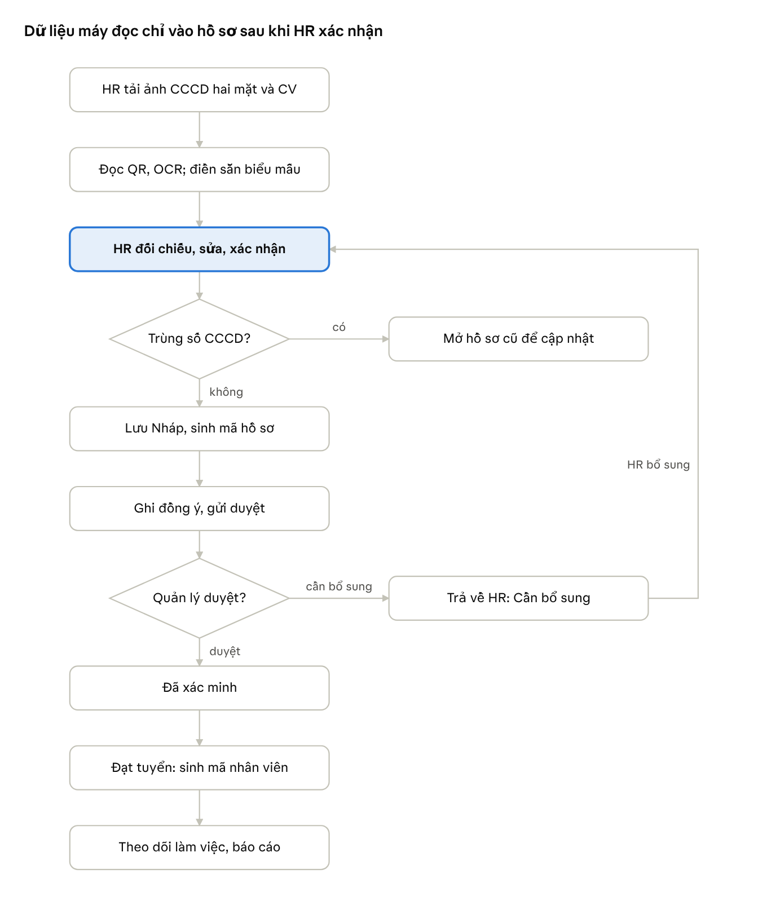

# Yêu cầu xây dựng phần mềm PA Worker – Quản lý hồ sơ công nhân

Phiên bản 1.0 · Ngày 21/11/2026 · Khách hàng đã duyệt · Đơn vị phát triển: QQIT

## I. Vai trò, mục tiêu và phạm vi

Phần mềm **PA Worker – Phần mềm quản lý hồ sơ công nhân** là sản phẩm minh chứng cho khóa luận tốt nghiệp ngành Quản trị văn phòng. Nó mô phỏng việc số hóa hồ sơ công nhân tại một doanh nghiệp sản xuất.

| Thông tin sản phẩm   | Nội dung                                                                                                                                                                                                    |
|----------------------|-------------------------------------------------------------------------------------------------------------------------------------------------------------------------------------------------------------|
| Tên phần mềm         | PA Worker                                                                                                                                                                                                   |
| Tên đầy đủ           | PA Worker – Phần mềm quản lý hồ sơ công nhân                                                                                                                                                                |
| Đơn vị phát triển    | QQIT                                                                                                                                                                                                        |
| Phiên bản bàn giao   | 1.0                                                                                                                                                                                                         |
| Hiển thị thương hiệu | Logo và tên PA Worker ở trang đăng nhập và góc trên menu; chân trang mọi trang ghi “PA Worker v1.0 · Phát triển bởi QQIT”; trang “Giới thiệu” ghi tên phần mềm, đơn vị phát triển, phiên bản, năm phát hành |
| Logo                 | QQIT cung cấp file logo khi triển khai; trước đó dùng logo chữ “PA Worker” màu xanh navy                                                                                                                    |

**Vai trò của người thực hiện:** chuyên gia phân tích nghiệp vụ nhân sự – văn phòng, kiến trúc sư phần mềm và lập trình viên full-stack.

### Mục tiêu

1.  Số hóa hồ sơ công nhân từ giấy tờ và tệp điện tử, quản lý tập trung một nơi.

2.  Rút ngắn thời gian nhập liệu nhờ đọc tự động CCCD/thẻ Căn cước, có nhân viên xác nhận trước khi lưu.

3.  Theo dõi vòng đời hồ sơ: từ tiếp nhận ứng viên đến khi công nhân nghỉ việc và lưu trữ.

4.  Biết ngay hồ sơ nào còn thiếu giấy tờ, hồ sơ nào chờ duyệt.

5.  Tra cứu, thống kê và xuất báo cáo nhanh.

6.  Bảo vệ dữ liệu cá nhân theo quy định hiện hành.

### Bối cảnh triển khai

| Hạng mục              | Yêu cầu                                                                                                                                                                                                        |
|-----------------------|----------------------------------------------------------------------------------------------------------------------------------------------------------------------------------------------------------------|
| Môi trường chạy       | Web app chạy cục bộ trên một máy tính bằng Docker; các máy khác trong mạng nội bộ truy cập qua trình duyệt. Không bắt buộc thuê máy chủ. Hệ điều hành: Windows 10/11 hoặc macOS (hướng dẫn cài đặt cho cả hai) |
| Người cài đặt và demo | Sinh viên ngành Quản trị văn phòng. Trình độ lập trình: chưa có kinh nghiệm, nên mọi hướng dẫn phải viết cho người không chuyên IT                                                                             |
| Quy mô mô phỏng       | 1 doanh nghiệp, khoảng 500 công nhân, 5–10 người dùng hệ thống                                                                                                                                                 |
| Ngân sách             | 0 đồng. Mọi chức năng bắt buộc phải chạy được không cần dịch vụ trả phí và không cần Internet                                                                                                                  |
| Cài đặt               | Máy đã có Docker Desktop: khởi động toàn bộ hệ thống bằng một lệnh docker compose up; lần đầu cài xong trong dưới 30 phút theo hướng dẫn                                                                       |

### Công nghệ đề xuất

Ưu tiên công nghệ ít thành phần, dễ cài và dễ giải thích trước hội đồng. Nếu người thực hiện đề xuất khác, phải nêu lý do và chờ duyệt.

| Thành phần       | Đề xuất                                                                          |
|------------------|----------------------------------------------------------------------------------|
| Backend          | Python 3.12 + Django 5.2 LTS (có sẵn đăng nhập, phân quyền, ORM, trang quản trị) |
| Giao diện        | Django templates + Bootstrap 5; tương tác nhỏ bằng HTMX; biểu đồ bằng Chart.js   |
| Cơ sở dữ liệu    | PostgreSQL 16 chạy trong Docker; SQLite chỉ dùng khi chạy thử không có Docker    |
| Đọc QR CCCD      | OpenCV + pyzbar (offline)                                                        |
| OCR dự phòng     | Tesseract có gói tiếng Việt (offline)                                            |
| Trích văn bản CV | pdfplumber (PDF), python-docx (DOCX), Tesseract (ảnh)                            |
| Xuất báo cáo     | openpyxl (Excel), trình duyệt in ra PDF                                          |

### Triển khai bằng Docker

Toàn bộ hệ thống đóng gói bằng Docker Compose, nên máy nào cài cũng chạy giống nhau, không phải cài Python, PostgreSQL hay Tesseract thủ công.

| Thành phần                  | Yêu cầu                                                                                                                    |
|-----------------------------|----------------------------------------------------------------------------------------------------------------------------|
| Container web               | Django + Gunicorn; image cài sẵn Tesseract (gói tiếng Việt) và thư viện đọc QR; tự chạy migration khi khởi động            |
| Container db                | PostgreSQL 16; chỉ container web truy cập được, không mở cổng ra ngoài                                                     |
| Dữ liệu bền vững            | CSDL và thư mục tệp đính kèm nằm trong volume; dựng lại container không mất dữ liệu                                        |
| Cấu hình                    | Mật khẩu CSDL, SECRET_KEY, khóa mã hóa nằm trong tệp .env (kèm .env.example mẫu), không đưa lên Git                        |
| Dữ liệu mẫu                 | Một lệnh nạp tài khoản mẫu và dữ liệu giả lập                                                                              |
| Sao lưu, phục hồi           | Kịch bản sao lưu CSDL (pg_dump) kèm thư mục tệp ra một file nén có ngày giờ; kịch bản phục hồi ngược lại                   |
| Khởi động nhanh             | File PA Worker.bat (Windows) hoặc PA Worker.command (macOS): chạy docker compose up rồi mở trình duyệt vào trang đăng nhập |
| HTTPS (khi triển khai thật) | Thêm container reverse proxy (Caddy hoặc Nginx) để cấp HTTPS; khi demo trên localhost được bỏ qua                          |

Docker Desktop trên Windows cần bật WSL 2 và ảo hóa trong BIOS; trên macOS cài đúng bản cho chip Intel hoặc Apple Silicon. Hướng dẫn cài đặt phải có bước kiểm tra này, và vẫn giữ cách chạy không cần Docker (Python + SQLite) làm phương án dự phòng nếu máy demo không cài được Docker.

### Phạm vi

- **Bắt buộc (MVP):** các phân hệ ở mục IV và V.

- **Mở rộng:** các chức năng ở Phụ lục, chỉ làm khi MVP đã đạt.

- **Ngoài phạm vi:** chấm công, tính lương, bảo hiểm xã hội, kết nối Cơ sở dữ liệu quốc gia về dân cư, đọc chip CCCD bằng NFC.

## II. Đối tượng quản lý và vòng đời hồ sơ

Mỗi người có **một hồ sơ duy nhất**, đi qua ba giai đoạn: ứng viên → công nhân → đã nghỉ việc. Ba loại trạng thái bên dưới độc lập với nhau và là danh sách duy nhất được dùng trong toàn hệ thống (dashboard, bộ lọc, báo cáo).

### Hai loại mã

| Mã           | Khi nào sinh                          | Ví dụ         | Ghi chú                                        |
|--------------|---------------------------------------|---------------|------------------------------------------------|
| Mã hồ sơ     | Ngay khi lưu hồ sơ lần đầu            | HS-2026-00123 | Mọi người đều có, kể cả ứng viên không đạt     |
| Mã nhân viên | Khi hồ sơ chuyển sang “Chờ nhận việc” | CN-00456      | Chỉ có khi được tuyển; không tái sử dụng mã cũ |

Quy tắc sinh mã (tiền tố, năm, số chữ số) cấu hình được trong phần Cài đặt. Cả hai mã đều duy nhất và không sửa được sau khi sinh.

### 1. Trạng thái tuyển dụng (cho mỗi lần ứng tuyển)

| Trạng thái       | Ý nghĩa                     |
|------------------|-----------------------------|
| Mới nộp          | Vừa tiếp nhận CV/hồ sơ      |
| Đang sàng lọc    | HR đang xem xét             |
| Hẹn phỏng vấn    | Đã có lịch phỏng vấn        |
| Đạt              | Đạt yêu cầu, chờ nhận việc  |
| Không đạt        | Bị loại, bắt buộc ghi lý do |
| Ứng viên từ chối | Ứng viên không nhận việc    |

Một người có thể ứng tuyển nhiều lần; mỗi lần là một bản ghi ứng tuyển riêng, cùng một hồ sơ.

### 2. Trạng thái xác minh hồ sơ

| Trạng thái  | Ý nghĩa                                             | Ai chuyển       |
|-------------|-----------------------------------------------------|-----------------|
| Nháp        | Đang nhập, chưa gửi duyệt                           | HR              |
| Chờ duyệt   | HR đã nhập xong, gửi Quản lý nhân sự                | HR              |
| Cần bổ sung | Quản lý trả lại, bắt buộc ghi nội dung cần bổ sung  | Quản lý         |
| Đã xác minh | Quản lý đã đối chiếu với bản gốc và duyệt           | Quản lý         |
| Bị từ chối  | Thông tin sai hoặc giấy tờ không hợp lệ, ghi lý do  | Quản lý         |
| Lưu trữ     | Hồ sơ đã đóng (nghỉ việc hoặc không tuyển), chỉ xem | HR hoặc tự động |

### 3. Trạng thái làm việc (chỉ áp dụng khi đã có mã nhân viên)

| Trạng thái    | Ý nghĩa                                                                         |
|---------------|---------------------------------------------------------------------------------|
| Chờ nhận việc | Đã tuyển, chưa đến ngày bắt đầu                                                 |
| Thử việc      | Đang trong thời gian thử việc                                                   |
| Đang làm việc | Chính thức                                                                      |
| Tạm hoãn      | Tạm hoãn thực hiện hợp đồng (thai sản dài ngày, nghĩa vụ quân sự…)              |
| Đã nghỉ việc  | Bắt buộc ghi ngày nghỉ và lý do: tự nghỉ, hết hợp đồng, chấm dứt hợp đồng, khác |

### Chỉ số tự tính (không phải trạng thái)

- **Thiếu giấy tờ:** hồ sơ chưa có đủ các loại tài liệu bắt buộc (danh sách bắt buộc cấu hình trong Cài đặt; mặc định: CCCD hai mặt, ảnh chân dung, CV hoặc đơn xin việc).

- **Hoàn thiện:** “Đã xác minh” **và** không thiếu giấy tờ.

- **Sắp hết hạn:** CCCD hoặc hợp đồng hết hạn trong 30 ngày tới (số ngày cấu hình được).

Mọi số liệu trên Dashboard phải tính từ ba loại trạng thái và ba chỉ số này, không tạo thêm khái niệm khác.

## III. Vai trò người dùng và phân quyền

Hệ thống có bốn vai trò cố định. Quyền được kiểm tra ở phía máy chủ, không chỉ ẩn nút trên giao diện.

| Thao tác                                              | Admin                                   | Quản lý nhân sự | Nhân viên HR                          | Viewer                                  |
|-------------------------------------------------------|-----------------------------------------|-----------------|---------------------------------------|-----------------------------------------|
| Xem danh sách và chi tiết hồ sơ                       | Có                                      | Có              | Có                                    | Có, không có trường nhạy cảm            |
| Xem đầy đủ số CCCD, địa chỉ, ảnh CCCD                 | Có                                      | Có              | Có                                    | Không (số CCCD hiện dạng 0791•••••2345) |
| Thêm, sửa hồ sơ; tải tài liệu; chạy nhận diện CCCD/CV | Có                                      | Có              | Có                                    | Không                                   |
| Gửi duyệt                                             | Có                                      | Có              | Có                                    | Không                                   |
| Duyệt, trả lại, từ chối hồ sơ                         | Có                                      | Có              | Không                                 | Không                                   |
| Tải xuống tài liệu gốc                                | Có                                      | Có              | Có                                    | Không                                   |
| Thay thế tài liệu (giữ bản cũ trong lịch sử)          | Có                                      | Có              | Có, khi hồ sơ ở Nháp hoặc Cần bổ sung | Không                                   |
| Xem thống kê, xuất báo cáo                            | Có                                      | Có              | Có                                    | Chỉ xem thống kê                        |
| Xem nhật ký thao tác                                  | Có                                      | Có              | Không                                 | Không                                   |
| Quản lý tài khoản, danh mục, cài đặt                  | Có                                      | Không           | Không                                 | Không                                   |
| Xóa hồ sơ                                             | Không ai xóa cứng; chỉ chuyển “Lưu trữ” |                 |                                       |                                         |
| Sửa hoặc xóa nhật ký thao tác                         | Không ai, kể cả Admin                   |                 |                                       |                                         |

**Quy tắc phê duyệt:** người nhập hồ sơ không được tự duyệt hồ sơ của mình. Khi hồ sơ ở “Đã xác minh” mà có người sửa trường định danh (họ tên, ngày sinh, số CCCD), hồ sơ tự quay về “Chờ duyệt”.

## IV. Các phân hệ chức năng bắt buộc (MVP)

Tám phân hệ dưới đây phải hoạt động thật và liên kết với nhau. Phân hệ nhập CCCD/CV được mô tả riêng ở mục V.

### 1. Đăng nhập và tài khoản

- Đăng nhập bằng tên tài khoản và mật khẩu; đăng xuất; đổi mật khẩu.

- Khóa tài khoản 15 phút sau 5 lần nhập sai liên tiếp. Tự đăng xuất sau 30 phút không thao tác.

- Quên mật khẩu: Admin đặt lại mật khẩu tạm, người dùng buộc đổi ở lần đăng nhập sau (không cần máy chủ email).

- Admin tạo, khóa, mở khóa tài khoản và gán vai trò.

- Ghi lịch sử đăng nhập: thời gian, tài khoản, địa chỉ IP, thành công hay thất bại.

### 2. Dashboard

Thẻ số liệu (bấm vào mỗi thẻ mở danh sách đã lọc sẵn tương ứng):

- Tổng số hồ sơ (không tính Lưu trữ)

- Đang làm việc (Thử việc + Đang làm việc)

- Hồ sơ mới trong tháng

- Chờ duyệt

- Thiếu giấy tờ

- Hoàn thiện

- Đang tuyển dụng (Mới nộp, Đang sàng lọc, Hẹn phỏng vấn)

- Nghỉ việc trong tháng

- Hợp đồng sắp hết hạn

Biểu đồ:

- Công nhân vào làm và nghỉ việc theo tháng (12 tháng gần nhất)

- Công nhân theo phòng ban/bộ phận

- Cơ cấu theo giới tính, nhóm tuổi (18–25, 26–35, 36–45, trên 45), trình độ học vấn

- Hồ sơ theo trạng thái xác minh

### 3. Hồ sơ công nhân

- Thêm hồ sơ bằng tay hoặc từ CCCD/CV (mục V); sửa; xem chi tiết; gửi duyệt; chuyển Lưu trữ.

- Trang chi tiết chia tab: Thông tin cá nhân · Tuyển dụng & CV · Quá trình làm việc · Tài liệu · Lịch sử thay đổi.

- Kiểm tra dữ liệu: số CCCD 12 chữ số và không trùng; số điện thoại 10 chữ số; tuổi từ 18 trở lên (cảnh báo nếu dưới 18); ngày cấp sau ngày sinh; email đúng định dạng.

- Nhập hàng loạt từ file Excel mẫu, có báo lỗi từng dòng (để số hóa hồ sơ đang lưu trên Excel). Hồ sơ nhập vào ở trạng thái Nháp.

### 4. Tuyển dụng và CV

- Ghi nhận mỗi lần ứng tuyển: vị trí, ngày, nguồn (danh mục), mức lương mong muốn, ngày có thể nhận việc, trạng thái, ghi chú phỏng vấn.

- Danh sách học vấn, chứng chỉ, kinh nghiệm làm việc (thêm nhiều dòng).

- Khi chuyển sang “Đạt”, có nút “Tiếp nhận vào làm”: sinh mã nhân viên và mở form quá trình làm việc.

### 5. Quá trình làm việc và hợp đồng

- Thông tin hiện tại: ngày tiếp nhận, ngày bắt đầu, phòng ban, bộ phận, tổ sản xuất, chức danh, ca làm việc, người quản lý trực tiếp, trạng thái làm việc.

- Mỗi lần điều chuyển, đổi chức danh hoặc đổi trạng thái tạo một dòng lịch sử có ngày hiệu lực, số quyết định, lý do; không ghi đè.

- Danh sách hợp đồng: số hợp đồng, loại (thử việc / xác định thời hạn / không xác định thời hạn), ngày ký, ngày hiệu lực, ngày hết hạn, tệp đính kèm.

### 6. Tài liệu hồ sơ

- Mỗi hồ sơ có một thư mục tài liệu; loại tài liệu lấy từ danh mục (CCCD mặt trước, CCCD mặt sau, ảnh chân dung, CV, đơn xin việc, bằng cấp, chứng chỉ, hợp đồng, quyết định tiếp nhận, khác).

- Định dạng cho phép: JPG, PNG, PDF, DOC, DOCX; tối đa 10 MB mỗi tệp.

- Mỗi tài liệu lưu: loại, tên tệp, ngày tải, người tải, trạng thái xác minh (Chưa xác minh / Đã đối chiếu bản gốc / Không hợp lệ), ghi chú.

- Xem trước ảnh và PDF ngay trên trình duyệt. Thay thế tài liệu thì bản cũ được giữ lại (ẩn), không xóa.

- Hiển thị danh sách “còn thiếu” theo danh mục tài liệu bắt buộc.

### 7. Tìm kiếm và tra cứu

- Ô tìm nhanh trên thanh trên cùng: tìm theo mã hồ sơ, mã nhân viên, họ tên (không phân biệt dấu), số điện thoại. Tìm theo số CCCD chỉ với vai trò có quyền.

- Bộ lọc: phòng ban, bộ phận, chức danh, trình độ, ba loại trạng thái, thiếu giấy tờ, khoảng ngày tiếp nhận.

- Cột danh sách: STT \| Mã NV \| Họ và tên \| Ngày sinh \| Giới tính \| SĐT \| Bộ phận \| Chức danh \| Ngày vào làm \| Trạng thái hồ sơ \| Trạng thái làm việc \| Thao tác.

- Sắp xếp theo cột, phân trang 20 dòng, giữ bộ lọc khi quay lại trang.

### 8. Thống kê, báo cáo và nhật ký

- Báo cáo theo khoảng thời gian và phòng ban: tổng số, giới tính, nhóm tuổi, trình độ, chức danh, hồ sơ hoàn thiện/chưa hoàn thiện, hồ sơ mới theo tháng, đang làm/đã nghỉ.

- Xuất Excel; in trực tiếp (bản in có tiêu đề, ngày lập, người lập). Xuất danh sách đang lọc ra Excel.

- File xuất che số CCCD nếu người xuất không có quyền xem đầy đủ. Mỗi lần xuất được ghi nhật ký.

- Nhật ký thao tác ghi: ai, lúc nào, hành động, hồ sơ nào, giá trị trước và sau từng trường. Ghi cả việc xem số CCCD đầy đủ và tải tài liệu xuống.

Danh mục (phòng ban, bộ phận, tổ, chức danh, ca làm việc, loại tài liệu, nguồn ứng tuyển) do Admin quản lý trong trang Cài đặt. Mục đang được dùng thì chỉ ngừng sử dụng, không xóa.

## V. Nhập hồ sơ từ CCCD/thẻ Căn cước và CV

Đây là chức năng trọng tâm. Mặc định mọi xử lý chạy **ngay trên máy**, không gửi ảnh giấy tờ ra dịch vụ bên ngoài.

### Loại giấy tờ phải hỗ trợ

| Loại                        | Thông tin mặt trước                                                                          | Thông tin mặt sau                                                | Cách đọc chính         |
|-----------------------------|----------------------------------------------------------------------------------------------|------------------------------------------------------------------|------------------------|
| CCCD gắn chip (mẫu 2021)    | Số, họ tên, ngày sinh, giới tính, quốc tịch, quê quán, nơi thường trú, có giá trị đến, mã QR | Ngày cấp, nơi cấp, đặc điểm nhân dạng                            | Đọc mã QR              |
| Thẻ Căn cước (từ 01/7/2024) | Số định danh, họ tên, ngày sinh, giới tính, quốc tịch                                        | Nơi cư trú, nơi đăng ký khai sinh, ngày cấp, ngày hết hạn, mã QR | Đọc mã QR, OCR bổ sung |
| CCCD mã vạch (mẫu 2016)     | Giống mẫu 2021, không có mã QR chứa thông tin                                                | Ngày cấp, nơi cấp                                                | OCR                    |

Hệ thống lưu trường **loại giấy tờ** và có đủ trường cho cả hai mẫu: “quê quán” (mẫu cũ) và “nơi đăng ký khai sinh” (mẫu mới). Trường nào giấy tờ không có thì để trống, không suy ra từ trường khác.

### Thứ tự xử lý CCCD

1.  **Kiểm tra ảnh:** độ phân giải tối thiểu 1000 px chiều ngang, độ nét, độ sáng. Ảnh kém thì cảnh báo và cho chụp lại, vẫn cho phép nhập tay.

2.  **Đọc mã QR** (offline). Nếu đọc được, điền các trường có trong QR và đánh dấu nguồn “QR”. Cấu trúc dữ liệu QR của từng mẫu thẻ phải được kiểm chứng bằng ảnh mẫu trước khi viết bộ tách trường.

3.  **OCR offline** (Tesseract tiếng Việt) cho các trường còn thiếu hoặc khi không có QR. Trường từ OCR đánh dấu nguồn “OCR” kèm độ tin cậy.

4.  **API trả phí (tùy chọn, tắt mặc định):** có thể cấu hình một dịch vụ OCR CCCD của bên thứ ba. Khi bật, hệ thống phải hiện cảnh báo rằng ảnh sẽ được gửi ra ngoài và ghi nhật ký mỗi lần gửi. Phần này không bắt buộc để nghiệm thu.

### Màn hình đối chiếu

- Bên trái: ảnh CCCD (phóng to, xoay được). Bên phải: form đã điền sẵn.

- Mỗi trường hiện nguồn: QR / OCR / Nhập tay. Trường OCR có độ tin cậy dưới ngưỡng (mặc định 80%) được tô vàng và phải bấm xác nhận từng trường.

- Chữ bị mờ hoặc thiếu thì để trống, không đoán.

- Nút “Lưu hồ sơ” chỉ bấm được khi mọi trường tô vàng đã được xác nhận. Trước khi bấm, dữ liệu nhận diện không được ghi vào bảng hồ sơ.

- Kiểm tra trùng ngay khi có số CCCD: nếu đã có hồ sơ cùng số, hiện hồ sơ đó và cho chọn “Mở hồ sơ cũ” (ví dụ công nhân quay lại làm) thay vì tạo mới. Cảnh báo thêm khi trùng họ tên + ngày sinh.

- Lưu vết: trường nào do máy đọc, trường nào người sửa, ai xác nhận.

### CV

- Nhận PDF, DOC, DOCX, JPG, PNG. Trích toàn bộ văn bản và hiển thị cạnh form.

- Tự nhận ra các trường có dạng rõ ràng: số điện thoại, email, ngày tháng, tên các đề mục (Học vấn, Kinh nghiệm, Kỹ năng…).

- HR bôi đen đoạn văn bản và bấm “Đưa vào trường…” để gán vào học vấn, kinh nghiệm, chứng chỉ, kỹ năng.

- Không tự tạo thông tin không có trong CV. Việc dùng mô hình AI để tách CV tự động thuộc phần mở rộng (Phụ lục).

### Dữ liệu thử nghiệm

Không dùng CCCD thật. Tự tạo 10–20 ảnh CCCD giả (thông tin hư cấu, có dòng chữ “MẪU – KHÔNG CÓ GIÁ TRỊ”) gồm QR giả cùng cấu trúc, để demo và đo độ chính xác.

## VI. Trường dữ liệu và cơ sở dữ liệu

Cơ sở dữ liệu quan hệ, chuẩn hóa tối thiểu dạng 3NF: mỗi thông tin lưu một chỗ, danh mục tách bảng riêng, dùng khóa ngoại. Bảng dưới đây là đề xuất; người thực hiện được điều chỉnh nhưng phải nêu lý do.

### Trường thông tin hồ sơ

| Nhóm                 | Trường                                                                                                                                               | Bắt buộc                                      |
|----------------------|------------------------------------------------------------------------------------------------------------------------------------------------------|-----------------------------------------------|
| Định danh            | Mã hồ sơ, họ và tên, ngày sinh, giới tính, quốc tịch                                                                                                 | Có                                            |
| Giấy tờ              | Loại giấy tờ, số định danh (12 số), ngày cấp, nơi cấp, ngày hết hạn, quê quán hoặc nơi đăng ký khai sinh, nơi thường trú/cư trú, số CMND cũ (nếu có) | Số định danh bắt buộc; còn lại nếu giấy tờ có |
| Liên hệ              | Số điện thoại, email, nơi ở hiện tại                                                                                                                 | SĐT và nơi ở hiện tại                         |
| Khẩn cấp             | Họ tên, mối quan hệ, số điện thoại người liên hệ                                                                                                     | Có                                            |
| Khác                 | Ảnh chân dung, ghi chú                                                                                                                               | Không                                         |
| Đồng ý xử lý dữ liệu | Đã đồng ý (có/không), ngày đồng ý, hình thức (ký giấy/xác nhận điện tử), tệp biên bản                                                                | Có, trước khi gửi duyệt                       |

Tình trạng hôn nhân và dân tộc **không thu thập** trong MVP. Chỉ bổ sung khi có mục đích nghiệp vụ cụ thể được ghi rõ (ví dụ báo cáo lao động theo yêu cầu cơ quan quản lý).

### Các bảng dữ liệu

| Bảng                         | Nội dung                                                                   | Liên kết chính                           |
|------------------------------|----------------------------------------------------------------------------|------------------------------------------|
| Users                        | Tài khoản, mật khẩu đã băm, trạng thái khóa                                | → Roles                                  |
| Roles                        | 4 vai trò cố định                                                          |                                          |
| LoginHistory                 | Lịch sử đăng nhập                                                          | → Users                                  |
| Workers                      | Hồ sơ: định danh, liên hệ, trạng thái xác minh, mã nhân viên (có thể rỗng) |                                          |
| IdentityDocuments            | Thông tin CCCD/Căn cước, nguồn từng trường (QR/OCR/tay)                    | → Workers                                |
| EmergencyContacts            | Người liên hệ khẩn cấp                                                     | → Workers                                |
| DataConsents                 | Ghi nhận đồng ý xử lý dữ liệu cá nhân                                      | → Workers                                |
| Applications                 | Mỗi lần ứng tuyển, trạng thái tuyển dụng                                   | → Workers, Positions, ApplicationSources |
| Education                    | Học vấn (nhiều dòng)                                                       | → Workers, EducationLevels               |
| Certificates                 | Chứng chỉ                                                                  | → Workers                                |
| WorkExperiences              | Kinh nghiệm trước đây                                                      | → Workers                                |
| Departments, Sections, Teams | Phòng ban → bộ phận → tổ sản xuất (cây 3 cấp)                              | Teams → Sections → Departments           |
| Positions                    | Chức danh                                                                  |                                          |
| Shifts                       | Ca làm việc                                                                |                                          |
| Employments                  | Thông tin làm việc hiện tại                                                | → Workers, Teams, Positions, Shifts      |
| EmploymentHistory            | Lịch sử điều chuyển và đổi trạng thái                                      | → Workers                                |
| Contracts                    | Hợp đồng lao động                                                          | → Workers, WorkerDocuments               |
| DocumentTypes                | Loại tài liệu, cờ “bắt buộc”                                               |                                          |
| WorkerDocuments              | Tệp đính kèm, phiên bản, trạng thái xác minh                               | → Workers, DocumentTypes, Users          |
| StatusChanges                | Lịch sử đổi trạng thái hồ sơ, kèm lý do                                    | → Workers, Users                         |
| AuditLogs                    | Nhật ký thao tác (chỉ thêm, không sửa/xóa)                                 | → Users                                  |
| Settings                     | Quy tắc sinh mã, ngưỡng cảnh báo, cấu hình OCR                             |                                          |

### Ràng buộc bắt buộc

- Duy nhất: mã hồ sơ, mã nhân viên, số định danh, tên tài khoản.

- Số định danh được **mã hóa khi lưu**; để kiểm tra trùng và tìm kiếm, lưu thêm một giá trị băm (hash) riêng.

- Tệp đính kèm lưu ngoài thư mục công khai của web, đặt tên ngẫu nhiên, chỉ tải qua đường dẫn có kiểm tra quyền.

- Không xóa cứng bản ghi có liên kết; dùng cờ ngừng sử dụng hoặc Lưu trữ.

## VII. Giao diện

Giao diện hoàn toàn tiếng Việt, màu chủ đạo xanh navy, xanh dương và trắng; menu bên trái, ô tìm nhanh phía trên, có logo và tên PA Worker, chân trang ghi đơn vị phát triển QQIT. Dùng tốt trên máy tính; trên điện thoại xem và tra cứu được (không bắt buộc tối ưu màn hình đối chiếu CCCD).

| \#  | Trang               | Nội dung chính                                                                 |
|-----|---------------------|--------------------------------------------------------------------------------|
| 1   | Đăng nhập           | Tài khoản, mật khẩu, thông báo lỗi rõ ràng                                     |
| 2   | Dashboard           | Thẻ số liệu bấm được, biểu đồ, danh sách việc cần làm (chờ duyệt, sắp hết hạn) |
| 3   | Danh sách công nhân | Bảng, bộ lọc, xuất Excel                                                       |
| 4   | Thêm hồ sơ          | Chọn: nhập tay / từ CCCD và CV / từ file Excel                                 |
| 5   | Nhập từ CCCD và CV  | Tải ảnh, màn hình đối chiếu hai cột (mục V)                                    |
| 6   | Chi tiết hồ sơ      | Các tab, nút gửi duyệt/duyệt theo quyền, dòng thời gian thay đổi               |
| 7   | Tuyển dụng          | Danh sách ứng viên theo trạng thái tuyển dụng                                  |
| 8   | Duyệt hồ sơ         | Hàng đợi “Chờ duyệt” cho Quản lý nhân sự                                       |
| 9   | Thống kê báo cáo    | Chọn loại báo cáo, khoảng thời gian, xuất/in                                   |
| 10  | Nhật ký thao tác    | Lọc theo người, hồ sơ, khoảng thời gian                                        |
| 11  | Quản lý tài khoản   | Tạo, khóa, đặt lại mật khẩu, gán vai trò                                       |
| 12  | Cài đặt             | Danh mục, quy tắc sinh mã, ngưỡng cảnh báo, cấu hình OCR                       |

Yêu cầu chung: mọi nút đều hoạt động; nút người dùng không có quyền thì ẩn; thao tác không hoàn tác được (duyệt, từ chối, lưu trữ) có hộp xác nhận; lỗi nhập liệu hiện ngay dưới ô bị sai.

### Yêu cầu chung (phi chức năng)

- Trình duyệt: Chrome và Edge bản mới nhất.

- Tốc độ: với 500 hồ sơ, mở danh sách, lọc, tìm kiếm dưới 2 giây; đọc QR một ảnh CCCD dưới 5 giây.

- Định dạng: ngày dd/mm/yyyy, giờ Việt Nam (GMT+7), tiếng Việt có dấu đúng trên màn hình, file Excel và bản in.

- Mật khẩu: tối thiểu 8 ký tự, có chữ và số; tài khoản mẫu buộc đổi mật khẩu lần đầu.

- Mã nguồn: quản lý bằng Git, có README, file cấu hình mẫu và chú thích tiếng Việt ở các phần nghiệp vụ chính; bản quyền mã nguồn thuộc QQIT.

## VIII. Bảo mật và bảo vệ dữ liệu cá nhân

Phần mềm xử lý số định danh và ảnh giấy tờ tùy thân, nên phải tuân thủ quy định hiện hành về bảo vệ dữ liệu cá nhân. Căn cứ áp dụng: Luật Bảo vệ dữ liệu cá nhân số 91/2025/QH15 và Nghị định 356/2025/NĐ-CP quy định chi tiết thi hành Luật, cùng có hiệu lực từ 01/01/2026.

### Kỹ thuật

- Mật khẩu băm bằng thuật toán chuẩn (PBKDF2/Argon2), không lưu dạng rõ.

- Mã hóa khi lưu: số định danh, số CMND cũ, địa chỉ thường trú. Khóa mã hóa nằm trong tệp cấu hình môi trường, không nằm trong mã nguồn.

- HTTPS khi triển khai thật (khi demo trên localhost được miễn, ghi rõ trong hướng dẫn).

- Chống các lỗi web phổ biến: SQL injection, XSS, CSRF, tải lên tệp độc (kiểm tra định dạng thật của tệp, không chỉ đuôi tên).

- Kiểm tra quyền ở máy chủ cho từng trang, từng API và từng tệp tải xuống.

- Sao lưu: lệnh/kịch bản sao lưu CSDL và thư mục tệp, có hướng dẫn phục hồi đã thử thành công.

### Nghiệp vụ

- Chỉ thu thập trường cần cho quản lý nhân sự (mục VI).

- Ghi nhận sự đồng ý xử lý dữ liệu trước khi hồ sơ được gửi duyệt; có mẫu văn bản đồng ý để in.

- Che số định danh với người không có quyền, trên màn hình và trong file xuất.

- Ghi nhật ký việc xem đầy đủ số định danh, tải tài liệu và xuất báo cáo.

- Thời hạn lưu trữ: hồ sơ ứng viên không đạt lưu tối đa 12 tháng kể từ ngày có kết quả tuyển dụng; hồ sơ công nhân đã nghỉ lưu theo quy định lưu trữ của doanh nghiệp, cấu hình được trong Cài đặt (mặc định 10 năm kể từ ngày nghỉ việc). Hết hạn thì hệ thống liệt kê để Admin duyệt hủy; việc hủy được ghi biên bản.

- Toàn bộ dữ liệu demo là dữ liệu giả lập.

## IX. Quy trình nghiệp vụ tiếp nhận hồ sơ

Quy trình có hai điểm kiểm soát do con người quyết định: HR xác nhận dữ liệu máy đọc, và Quản lý nhân sự duyệt hồ sơ.

Tóm tắt quy trình: (1) HR tải ảnh CCCD hai mặt và CV → (2) đọc QR, OCR, điền sẵn biểu mẫu → (3) HR đối chiếu, sửa, xác nhận → (4) trùng số CCCD? có: mở hồ sơ cũ để cập nhật; không: lưu Nháp, sinh mã hồ sơ → (5) ghi đồng ý, gửi duyệt → (6) Quản lý duyệt? cần bổ sung: trả về HR, quay lại bước 3; từ chối: Bị từ chối kèm lý do; duyệt: Đã xác minh → (7) đạt tuyển: sinh mã nhân viên → (8) theo dõi làm việc, báo cáo.

quy trình tiếp nhận hồ sơ · 2 điểm kiểm soát

Hồ sơ bị Quản lý từ chối chuyển sang “Bị từ chối” kèm lý do. Mọi bước đều được ghi vào nhật ký thao tác.

## X. Tiêu chí nghiệm thu

MVP đạt khi tất cả các kịch bản dưới đây chạy đúng trên bản cài mới theo hướng dẫn. Người thực hiện nộp kèm bảng kết quả kiểm thử (Đạt/Không đạt, ảnh chụp màn hình).

| \#  | Kịch bản                                                             | Kết quả mong đợi                                                                |
|-----|----------------------------------------------------------------------|---------------------------------------------------------------------------------|
| 1   | Máy mới chỉ có Docker Desktop, chạy docker compose up theo hướng dẫn | Chạy được trong 30 phút, có sẵn 4 tài khoản mẫu và khoảng 500 hồ sơ giả lập     |
| 2   | Viewer mở hồ sơ                                                      | Số CCCD bị che; gọi trực tiếp đường dẫn sửa hoặc tải tệp thì bị từ chối         |
| 3   | HR tải ảnh CCCD giả có QR                                            | Điền đúng 100% trường có trong QR trên bộ ảnh mẫu                               |
| 4   | HR tải ảnh CCCD không có QR                                          | OCR điền được; trường không chắc chắn tô vàng; chưa xác nhận thì không lưu được |
| 5   | Nhập CCCD đã có trong hệ thống                                       | Báo trùng, mở hồ sơ cũ, không tạo hồ sơ mới                                     |
| 6   | HR gửi duyệt → Quản lý trả lại → HR bổ sung → Quản lý duyệt          | Trạng thái đổi đúng từng bước, có lý do, có trong nhật ký                       |
| 7   | HR tự duyệt hồ sơ mình nhập                                          | Bị chặn                                                                         |
| 8   | Ứng viên “Đạt” → Tiếp nhận vào làm                                   | Sinh mã nhân viên đúng quy tắc, xuất hiện ở danh sách “Chờ nhận việc”           |
| 9   | Điều chuyển bộ phận                                                  | Thông tin hiện tại đổi, lịch sử giữ dòng cũ                                     |
| 10  | Hợp đồng hết hạn sau 20 ngày                                         | Hiện trong thẻ “Sắp hết hạn” trên Dashboard                                     |
| 11  | Bấm thẻ “Thiếu giấy tờ”                                              | Mở danh sách đã lọc, số dòng bằng số trên thẻ                                   |
| 12  | Tìm “nguyen van an” (không dấu)                                      | Ra hồ sơ “Nguyễn Văn An”                                                        |
| 13  | Xuất Excel danh sách đang lọc                                        | Số dòng và nội dung khớp màn hình; CCCD bị che theo quyền                       |
| 14  | Sửa họ tên một hồ sơ đã xác minh                                     | Quay về “Chờ duyệt”; nhật ký có giá trị cũ và mới                               |
| 15  | Nhập 5 lần sai mật khẩu                                              | Tài khoản bị khóa 15 phút                                                       |
| 16  | Nhập file Excel có 3 dòng lỗi                                        | Dòng đúng được nhập, báo rõ 3 dòng lỗi và lý do                                 |
| 17  | Sao lưu, xóa container và volume, dựng lại, phục hồi                 | Dữ liệu và tệp trở lại đầy đủ                                                   |

## XI. Yêu cầu đầu ra và kế hoạch giai đoạn

Làm theo đúng thứ tự. **Kết thúc mỗi giai đoạn phải dừng lại**, báo cáo đã làm gì, cách kiểm tra, và chờ duyệt trước khi sang giai đoạn sau.

1.  **Phân tích và thiết kế** (chưa viết code): sơ đồ kiến trúc, sơ đồ ERD, danh sách trường chi tiết, phác thảo giao diện 12 trang, danh sách câu hỏi còn vướng mắc.

2.  **Nền tảng:** khởi tạo dự án, Dockerfile và docker-compose.yml, CSDL, đăng nhập, phân quyền, danh mục, nhật ký thao tác, dữ liệu giả lập.

3.  **Hồ sơ và tài liệu:** thêm/sửa/xem hồ sơ, tải và xem tài liệu, kiểm tra trùng, quy trình duyệt.

4.  **Nhập từ CCCD và CV:** đọc QR, OCR, màn hình đối chiếu, bộ ảnh CCCD giả và bảng đo độ chính xác.

5.  **Tuyển dụng, quá trình làm việc, hợp đồng.**

6.  **Tìm kiếm, Dashboard, báo cáo, xuất Excel, nhập từ Excel.**

7.  **Kiểm thử:** chạy 17 kịch bản ở mục X và bộ kiểm thử tự động cho phân quyền, sinh mã, kiểm tra trùng.

8.  **Bàn giao:** hướng dẫn cài đặt từng bước cho người không chuyên IT (cài Docker Desktop, chạy hệ thống, sao lưu và phục hồi, xử lý lỗi thường gặp), hướng dẫn sử dụng theo vai trò, kịch bản demo 10 phút trước hội đồng.

Sản phẩm phục vụ chương nghiệp vụ của khóa luận (người thực hiện hỗ trợ soạn):

- Sơ đồ quy trình tiếp nhận hồ sơ trước và sau khi có phần mềm.

- Bảng so sánh thời gian xử lý một hồ sơ: thủ công và dùng phần mềm (đo trên dữ liệu giả lập).

- Bảng đối chiếu các biện pháp bảo vệ dữ liệu cá nhân của phần mềm với quy định pháp luật.

Nếu bất kỳ chức năng nào cần dịch vụ trả phí hoặc Internet, phải nói rõ trước khi làm và có phương án miễn phí chạy offline.

## Phụ lục: chức năng mở rộng

Chỉ làm sau khi MVP đạt đủ 17 kịch bản nghiệm thu, theo thứ tự ưu tiên:

1.  Thông báo trong ứng dụng (chuông thông báo): hồ sơ mới, chờ duyệt, bị trả lại, hợp đồng/CCCD sắp hết hạn, hồ sơ bị chỉnh sửa.

2.  Xuất báo cáo thành tệp PDF có định dạng văn bản hành chính.

3.  Tách CV tự động bằng mô hình AI (chạy trên máy hoặc qua API), vẫn qua bước xác nhận của HR.

4.  Kết nối API OCR CCCD trả phí (đã có chỗ cấu hình ở mục V).

5.  Quên mật khẩu qua email.

6.  Sao lưu và phục hồi bằng nút bấm trong trang Cài đặt.

7.  In thẻ nhân viên hoặc phiếu thông tin hồ sơ theo mẫu.

## Xác nhận nghiệm thu tài liệu yêu cầu

Hai bên thống nhất nội dung tài liệu yêu cầu phần mềm PA Worker nêu trên làm căn cứ để xây dựng và nghiệm thu sản phẩm. Mọi thay đổi sau ngày ký phải được hai bên xác nhận bằng văn bản.

|                  | Bên A (Khách hàng)                                 | Bên B (Đơn vị phát triển)                        |
|------------------|----------------------------------------------------|--------------------------------------------------|
| Tên đơn vị       | ................................................   | QQIT                                             |
| Người đại diện   | ................................................   | ................................................ |
| Chức vụ          | ................................................   | ................................................ |
| Ý kiến           | ☐ Đồng ý ☐ Đồng ý, có góp ý kèm theo ☐ Chưa đồng ý |                                                  |
| Ngày ký          | ..../..../20....                                   | ..../..../20....                                 |
| Chữ ký, đóng dấu |                                                    |                                                  |
